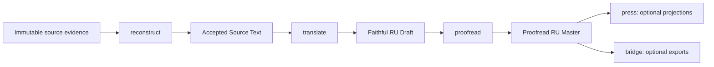

# Sourcefold — operational handoff specification

- Версия: `2026-10-11.1`.
- Целевая аудитория: новая модель-оркестратор, включая Claude Opus 5.5.
- Репозиторий: `https://github.com/Hramgithub/Sorceforge.git`.
- Изученная база: `7c880d60320ba11c7a80f62fb804722cfac1548b`.
- Статус: handoff-документация; не release acceptance продукта, книги или OCR.

Краткое введение: [MODEL_HANDOFF_SUMMARY.md](MODEL_HANDOFF_SUMMARY.md).

## 1. Идентичность продукта и граница снимка

| Поле | Значение |
|---|---|
| Product | `Sourcefold` |
| Repository slug | `Sorceforge` — историческая орфография remote, не rename продукта |
| Branch | `main` |
| Product root | `Sourcefold/` |
| Изученная база | `7c880d60320ba11c7a80f62fb804722cfac1548b` |
| Standalone source | NRI `22fafc14942e925b2e5f088f3c7ab1cd8efe3003` |
| Baseline inventory | 3987 tracked files, из них 3981 под `Sourcefold/` и 6 root files |
| Current phase | Phase 0 active |
| Current global gate | Gate 1 Source Profile active |
| Release meaning | accepted standalone source/evidence snapshot, не production runtime |

Вложенная структура `Sourcefold/` намеренна: roadmap validator и evidence
contracts используют канонические пути `Sourcefold/...` от корня репозитория.
Flattening — отдельная миграция, а не косметическая перестановка.

Standalone import сохраняет измеренные байты исходного working tree. Из-за
`core.autocrlf` отдельные text blob IDs исходного NRI могли отличаться от его
working-tree bytes; это записано в export receipts и не является скрытой
потерей данных.

## 2. Источники истины

При конфликте использовать такой порядок:

1. прямое текущее решение пользователя и действующие root/project rules;
2. plan/context активной цели и опубликованный Git revision;
3. точные bounded decision records, manifests, schemas, payload hashes и
   predecessor links для рассматриваемой lane;
4. `docs/roadmap/roadmap.yaml` для planning-node state и dependencies;
5. верхний current checkpoint `PROJECT_STATUS.md` как rollup, но не acceptance
   ledger;
6. architecture/contracts для intended behavior, с различением draft,
   accepted и implemented;
7. старые checkpoints, model labels, PIDs, `current_head` и prose-комментарии
   только как historical provenance.

Если roadmap глобально active, а точный decision record принимает ограниченный
scope, сохранять оба утверждения. Не расширять узкое принятие и не отменять его
более грубой строкой roadmap.

## 3. Определение продукта

### 3.1 Core pipeline



| Module | Принимает | Обязан сохранить | Выдаёт |
|---|---|---|---|
| `reconstruct` | immutable source evidence, extraction/OCR views, decisions | meaning, order, structure, tables/cards/data, traceability | accepted source text |
| `translate` | accepted source text, glossary/style authority | meaning, rules/data, structure, terminology | faithful RU draft |
| `proofread` | source + RU draft + review decisions | meaning/data while improving Russian readability | accepted RU master |
| `press` | accepted RU master | master text and declared structure | Markdown/HTML/PDF projection |
| `bridge` | accepted artifacts | identity, provenance and explicit target contract | integration/export package |

Каждый downstream-модуль требует принятого predecessor. Проекция или экспорт
не могут исправить плохую реконструкцию либо самовольно принять перевод.

### 3.2 Не является продуктом

- автоматическое принятие OCR по similarity score;
- универсальный production-ready PDF-to-Russian-book pipeline;
- продолжение `translator` под новым именем;
- runtime для KB generation или RuleAtlas;
- web service/daemon;
- permission store, из которого можно вывести новое разрешение по наличию
  старого report;
- возможность считать review crop безопасным OCR input;
- гарантия, что исторический абсолютный путь работает на новом host.

## 4. Acceptance и artifact vocabulary

Использовать термины строго:

- `observed` / metric — измерение;
- `passed` — конкретная проверка прошла;
- `conformant` — artifact соответствует machine contract;
- `ready` — выполнены prerequisites к следующему решению;
- `promotable` — artifact может быть рассмотрен для promotion в названном
  scope;
- `accepted` — явное scoped human/operator decision;
- `released` — independently reviewed frozen candidate.

`coverage_summary`, `materialized`, `selected`, `bridge_removed`, `similarity
1.0` и `production_ready` — отдельные поля. Ни одно из них само по себе не
равно source acceptance, whole-Gate acceptance или release.

Принятие не транзитивно: accepted record не принимает всю страницу; accepted
page не принимает всю книгу; bounded Gate decision не закрывает весь roadmap.

## 5. Архитектурные слои

| Слой | Основные пути | Ответственность |
|---|---|---|
| Governance | root `AGENTS.md`, `docs/governance/nri_goal_governance.md`, `Sourcefold/AGENTS.md` | роли, canonical state, handoffs, release gate |
| Product boundary | `docs/architecture/product_boundary.md`, `module_contracts.md` | core/optional modules и predecessor rules |
| Module contracts | `contracts/*.md` | inputs, outputs, preservation, QA и failure behavior |
| Quality | `docs/quality/acceptance_criteria.md` | minimum acceptance surfaces |
| Artifact schema | `manifests/artifact_manifest.schema.json` | generic stage/type/input/output/tool/model/QA metadata |
| Phase/Gate model | Phase-0 charter, hierarchy, qualification protocol, acceptance matrix | `Phase -> Gate -> Component -> Subcomponent -> Parameter -> Evidence` |
| Authorization | `scripts/bounded_authorization_contract.py` и ledgers | exact action, inputs, outputs, limits, authority, expiry |
| Lifecycle/routes | `artifact_lifecycle_validation.py`, `route_cursor_transition.py` | stale/held/superseded handling и legal transitions |
| Reconstruction | semantic/page/crop/source scripts | geometry, order, semantic payload, review и acceptance |
| OCR diagnosis | input-surface policy и scoped `build_*`/`run_*` | candidate generation, sealing, scoring, selector evidence |
| Planning | roadmap YAML, validator/viewer, documentation checkpoint | node/dependency state и documentation synchronization |

Generic manifest schema не гарантирует полную lineage сам по себе: SHA в
generic file reference может быть optional. Exact bounded contracts и producer
reports обязаны усиливать его там, где нужна sealed identity.

## 6. Что делали: этапы и результат

### 6.1 Product and governance foundation

Созданы product boundary, five module contracts, quality criteria, decision log,
role model, Phase/Gate hierarchy, artifact lineage и acceptance vocabulary.
Завершены отдельные foundation goals: scaffold, release roadmap, version ladder,
roadmap viewer, documentation checkpoint и package-backed validator.

### 6.2 Source qualification and mapping

Для Viral сохранены immutable PDF и governed candidate inputs. Созданы page,
region, document/content/art maps, pre-OCR map bundle и OCR preparation records.
Map evidence разделено от roadmap visualization: YAML хранит planning state, а
payloads — отдельные governed artifacts.

### 6.3 OCR benchmark and reconstruction

Зафиксированы engine/config identities, gold samples, candidate manifests,
benchmark results и remediation paths. Human review, QA и fixture admission
применялись только к точным records. Failed/superseded candidates сохранены как
lineage, а не удалены как мусор.

### 6.4 Page-level acceptance work

Страницы 001–020 проходили неодинаковые маршруты: accepted page-complete lanes,
fresh OCR probes, selected candidates, parked overview routes и later
remediation. Отдельные source slices и pages приняты в точном scope; это не
эквивалент accepted whole book.

### 6.5 OCR input-surface and selector work

Главный общий урок P017/P018: визуально удобный review crop не обязательно
OCR-safe. `ocr_input_surface_policy.py` разделяет review crops, candidate crops,
full-page regions и acceptance evidence. Candidate bytes должны быть sealed до
reference scoring.

Для P013 последовательно исследовали seam dedupe, geometry, lane order,
structural suppression и closure; для P012/P016/P020 — method-family варианты;
для P017/P018 — geometry probes. Selector replays собирали лучший существующий
evidence без притворства, что это fresh autonomous runtime.

### 6.6 Bounded Gate acceptance

`G1WGADR-G1-VIRAL-001` записывает bounded whole Gate 1 acceptance только для:

- pages `001`–`020`;
- названных G1FADAR fixture groups: одной positive и четырёх negative.

Он не принимает wider source profile, pages `021+`, translation, proofreading,
renderer/profile, production assembly или implementation.

### 6.7 Later P002 progress

После исходного mixed first-pass появилась отдельная P002 remediation chain.
`C01TEP002FRESHPASS-G1-VIRAL-001` фиксирует fresh OCR success, removal of bridge
и promotable status для страницы 002 после human-backed remediation. Старый
first-pass report не переписывается и остаётся историческим состоянием.

### 6.8 Standalone extraction

Все 3974 исходных Sourcefold paths были перенесены из NRI; активные guidance
files обновлены, root governance/layout rules добавлены. Governed fixtures
сохранены. Runtime dependencies, caches, browser profiles, temporary logs и
unrelated NRI projects исключены. Initial import, QA и independent release
review записаны отдельными коммитами/receipts.

## 7. Текущее состояние

### 7.1 Global planning state

| Node/layer | State |
|---|---|
| Phase 0 release charter | `active` |
| Gate 1 Source Profile | `active` |
| Gate 1 qualification protocol | `active` |
| Page-map readiness | `active` |
| Pre-OCR map model | `proposed` |
| Core 0.1 RC | `planned` |
| Later beta/production | `proposed` |
| Press/Bridge previews, broader OCR/KB | `deferred` |

### 7.2 Scoped accepted state

Наряду с active global nodes существуют exact accepted source records, page
decisions, admitted fixtures и bounded Gate acceptance. Они имеют силу только
для названных inputs/hashes/pages/groups и не являются текущей авторизацией на
повторный run.

### 7.3 Чего пока нет

- доказанного generalized production engine;
- whole-book accepted source и русского master;
- реализованного общего translate/proofread runtime;
- portable/pinned Python environment;
- portable Tesseract discovery contract;
- полностью зелёной test suite;
- права автоматически начать новую книгу.

## 8. Структура репозитория

Счётчики относятся к baseline `7c880d6`, до добавления этого handoff.

| Путь | Baseline count | Назначение |
|---|---:|---|
| repository entry/policy set | 6 files | пять root-level файлов плюс `docs/governance/nri_goal_governance.md` |
| `Sourcefold/` top level | 8 files | README, AGENTS, status, setup, package metadata |
| `Sourcefold/contracts/` | 5 files | reconstruct/translate/proofread/press/bridge contracts |
| `Sourcefold/docs/` | 193 files | architecture, quality, roadmap, goals и receipts |
| `Sourcefold/scripts/` | 186 files | bounded producers, validators, decisions и probes |
| `Sourcefold/tests/` | 179 files | contract, lineage, negative и regression checks |
| `Sourcefold/fixtures/` | 3408 files | candidate inputs и governed run evidence |
| `Sourcefold/manifests/` | 1 schema | generic artifact manifest |
| `Sourcefold/tools/roadmap-validator/` | 1 tool | YAML parser/validator |
| Total | 3987 tracked files | published standalone baseline |

Почти все fixtures находятся под:

```text
Sourcefold/fixtures/candidate_inputs/viral/render_trials/
  RT-G1-VIRAL-RENDER-001/
```

Там лежат не только «лучшие» результаты, но и quarantined, failed,
comparison-only и superseded evidence. Их нельзя массово чистить по имени.

### 8.1 Как находить нужное

- Старт задачи: root/project AGENTS, active goal plan/context.
- Продукт: `docs/architecture/` и relevant contract.
- Planning state: `docs/roadmap/roadmap.yaml`.
- Gate rules: Phase-0 qualification protocol и acceptance matrix.
- Реальный результат lane: точный report/manifest/summary под render-trial root.
- Код: связанный producer/validator в `scripts/`, затем focused tests.
- История standalone: `docs/plans/20261011-sourcefold-standalone-export/`.

Не читать все старые plans/receipts последовательно. Идентификатор current lane
и predecessor hashes дают более надёжный маршрут.

## 9. Технологии и зачем они нужны

| Технология | Роль | Ограничение сейчас |
|---|---|---|
| Python standard library | JSON/files/hash/subprocess, bounded producers и validators | scripts часто lane-specific, не единый CLI |
| pytest | contract negatives, lineage и regression gates | 13 известных падений; deps не locked |
| Pillow | crop geometry, preprocessing, image tests | требуется внешний environment |
| Tesseract English OCR | controlled OCR candidates, TXT/TSV evidence | hardcoded historical `D:\NRI` path |
| Node/npm | reproducible roadmap tooling | только dev tooling, не product runtime |
| `yaml@2.9.0` | real YAML parsing | lock существует только для Node tool |
| PowerShell | Windows wrappers/checkpoint | `-Apply` меняет canonical state |
| HTML/JS | roadmap reader | CDN dependency, не acceptance evidence |
| Git/SHA-256 | provenance, exact revision, byte identity | включить long paths; не путать working bytes и old blob normalization |

## 10. Проверки standalone и известный долг

Recorded export checks:

- roadmap: passed, 6 statuses / 7 lanes / 26 nodes / 25 edges /
  254 checkpoints;
- focused tests: 37 passed, 1 skipped;
- full collection: 1029;
- 989 passed, 27 skipped, 13 failed.

Двенадцать failures — stale evidence-lineage SHA assertions и воспроизведены в
исходном NRI с теми же hash pairs. Один failure требует отсутствующий
`D:\NRI\.tools\tesseract\tesseract.exe`.

Запрещённый «ремонт»:

- заменить expected hashes текущими только ради green suite;
- перезаписать immutable report/manifest;
- запустить старую authorization повторно;
- использовать reference text как independent OCR proof;
- синтезировать missing predecessor.

Нужен отдельный audit, который классифицирует каждое падение и предлагает
successor/remediation contract.

## 11. Безопасный bootstrap новой модели

### 11.1 Read-only preflight

```powershell
git status --short --branch
git rev-parse HEAD
git remote -v
```

После этого прочитать summary/spec, current AGENTS/governance, верхний status и
active goal. Не использовать hardcoded локальный путь из этого документа на
другой машине.

### 11.2 Roadmap validation

Из `Sourcefold/`:

```powershell
npm ci
npm run validate:roadmap
```

`npm ci` создаёт ignored `node_modules/` и требует сетевого доступа. Viewer не
заменяет validator.

### 11.3 Python validation

Команда формы:

```powershell
python -B -m pytest -p no:cacheprovider
```

сработает только в environment с pytest/Pillow и правильным import root.
Сначала записать interpreter и dependencies. Не утверждать, что чистый clone
воспроизводим, пока не появится versioned Python dependency declaration.

### 11.4 Execution boundary

Не запускать OCR/render/translation/proofreading до новой authorization. Для
будущего OCR сначала требуется portable runtime binding с executable/version/
language-data identity и отдельно принятый input-surface contract.

## 12. Протокол работы новой модели

### Перед изменением

- подтвердить branch/revision и чужие изменения;
- сформулировать bounded objective и Definition of Done;
- определить immutable inputs и exact predecessor;
- назвать earliest failing layer;
- проверить authority, expiry и invalidation;
- создать goal bundle для многошаговой работы;
- определить owned files и запрещённые области.

### Во время изменения

- предпочитать reusable contract/script/test вместо ручной правки artifact;
- создавать successor/new output root;
- seal candidate before reference scoring;
- не переписывать receipts/manifests/history;
- сохранять layout semantics и Russian terminology;
- различать observed, passed, accepted и released;
- записывать compact evidence, а не raw model transcript.

### Перед завершением

- проверить весь аналогичный scope, а не один seed example;
- пересобрать только authorized outputs;
- сверить paths/counts/hashes/predecessors;
- обновить current README/status при изменении структуры или state;
- отделить verified/pending/failed/blocked;
- получить bounded QA и independent release critic;
- commit/push выполнять только в рамках пользовательского запроса.

## 13. Опасные предположения

- **Неверно:** Sourcefold — пустой scaffold. Здесь есть реальный код и evidence.
- **Неверно:** Sourcefold — готовый production pipeline. Общий runtime не
  доказан.
- **Неверно:** Gate 1 полностью закрыт. Global roadmap остаётся active.
- **Неверно:** В Gate 1 ничего не принято. Есть exact bounded decisions.
- **Неверно:** Все страницы 001–020 freshly OCRed. First-pass mixed.
- **Неверно:** P002 fresh-pass означает автономный OCR. В цепочке есть bounded
  human-backed remediation.
- **Неверно:** 989 passed означает green suite. Есть 13 failures и 27 skips.
- **Неверно:** `translator` можно импортировать как Sourcefold runtime.
- **Неверно:** старое Telegram/receipt решение разрешает новый run.
- **Неверно:** имя GitHub `Sorceforge` меняет schema/product namespace.

## 14. Рекомендуемая следующая specification

### Название

`Sourcefold baseline debt and continuation audit`.

### Цель

Подготовить read-only decision packet, который объясняет 13 падающих тестов,
runtime portability и безопасную точку следующего bounded implementation шага.

### Результаты

1. Таблица 12 lineage failures: test node, asserted path, expected/actual hash,
   earliest mismatch, current successor и authority.
2. Классификация: historical supersession, line-ending/byte identity,
   stale sealed record или implementation defect.
3. Разбор Tesseract-dependent failure и portable runtime binding proposal.
4. Python dependency/bootstrap proposal с tested interpreter matrix.
5. Current lane map: original first-pass, bounded Gate acceptance и later P002
   successor state без их смешения.
6. Одна рекомендуемая implementation task с exact inputs/outputs/tests и
   отдельной authorization requirement.

### Acceptance gates

- ни один historical artifact не изменён;
- каждое утверждение имеет exact path/hash/evidence;
- полный набор тестов не назван зелёным;
- runtime proposal fail-closed при missing executable/data;
- audit не запускает OCR и не создаёт accepted text;
- следующий scope выбран main chat/user, а не выведен автоматически.

## 15. Вопросы, требующие решения пользователя

- Что важнее следующим: закрыть lineage/test debt, сделать portable runtime или
  продолжить конкретную page lane?
- Разрешено ли менять active producer scripts с историческими `D:\NRI` paths,
  сохраняя старые receipts неизменными?
- Какой Python dependency format и supported interpreter matrix принять?
- Допустим ли offline vendoring roadmap viewer dependency?
- Нужен ли перенос дополнительной NRI Git history или достаточно evidence и
  handoff-документов?
- Когда и для какого точного source package разрешать следующую OCR/translate
  задачу?

Не принимать эти решения молча.

## 16. Ключевые ссылки

- [Краткий handoff](MODEL_HANDOFF_SUMMARY.md)
- [Стартовый prompt](NEW_MODEL_PROMPT.md)
- [Project README](../../README.md)
- [Project status](../../PROJECT_STATUS.md)
- [Setup](../../SETUP.md)
- [Project guidance](../../AGENTS.md)
- [Root governance](../../../docs/governance/nri_goal_governance.md)
- [Product boundary](../architecture/product_boundary.md)
- [Module contracts](../architecture/module_contracts.md)
- [Roadmap](../roadmap/roadmap.yaml)
- [Phase 0 plan](../plans/20260715-sourcefold-phase-0-release-charter/plan.md)
- [Standalone export release](../plans/20261011-sourcefold-standalone-export/release.md)
- [Current handoff goal](../plans/20261011-sourcefold-model-handoff/plan.md)
