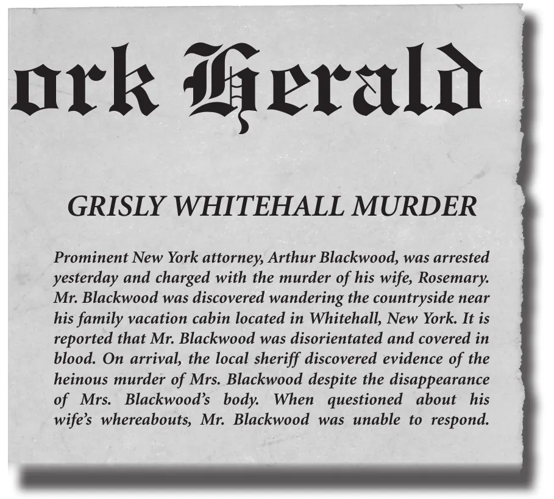

> **Раздатка «Погреб» 1**
>
> **…орк Геральд**
>
> *20 июля 1928 года*
>
> **ЖУТКОЕ УБИЙСТВО В УАЙТХОЛЛЕ**
>
> Видный нью-йоркский адвокат Артур Блэквуд вчера арестован и обвинён в убийстве своей жены Розмари. Мистера Блэквуда обнаружили бредущим по округе близ летнего домика его семьи в Уайтхолле, штат Нью-Йорк. Сообщается, что мистер Блэквуд был дезориентирован и весь в крови. Прибыв на место, местный шериф обнаружил следы чудовищного убийства миссис Блэквуд, хотя тело миссис Блэквуд пропало. На вопрос, где находится его жена, мистер Блэквуд ответить не смог.

*Клейн кладёт руку на странный ящик на столе: «Это магнитофон, я записываю на него беседы с подзащитными, чтобы вы могли услышать их точные слова — так, как они сами это сказали. Они совсем новые, а компания, которая их выпускает, — наш клиент, так что нам достался этот опытный образец». Клейн нажимает кнопку и говорит: «У Артура есть для вас сообщение».*

*Колёса начинают вращаться, и из ящика доносится скрипучий голос Артура:*

*«Кузен, прошу… ты должен мне помочь. Я не могу этого объяснить… Я никогда не верил в эти истории — слишком уж они были фантастичны, чтобы быть правдой, — но род Блэквудов и благословлён, и проклят! В погребе семейного домика живёт джинн, но, чтобы управлять им, нужно найти моё кольцо. Я уронил его, кажется, в погребе! Прошу, найди моё кольцо и докажи полиции, что джинн существует! Прошу, умоляю тебя! Найди моё кольцо — только оно может доказать мою невиновность!»*

*Клейн открывает папку из манильской бумаги и показывает вам фотографию погреба под домиком Блэквудов. На фотографии — тёмные земляные стены, вдоль них полки, и белый пол из дроблёных ракушек и гравия. Пол залит и забрызган кровью. «Как видите, никакого джинна нет, — говорит Клейн. — Бедный Артур был в страшном напряжении; в конце концов он сорвался и зарезал жену». Затем Клейн отдаёт вам ключ от домика и письмо, разрешающее доступ в дом, — на случай, если местные власти спросят, что вы там делаете. «Я вообще берусь за его просьбу обыскать погреб в поисках того, что очистит его имя, только потому, что всё ещё люблю и уважаю Артура. Удачи».*

Затем мистер Клейн предлагает сыщикам представиться друг другу — попросите игроков коротко описать своего персонажа и его роль. При необходимости Клейн может добавить следующее:

- Кларк, писатель, — кузен (кузина) Артура Блэквуда; Артур сам попросил о его (её) участии.
- Рамбергер, детектив, признан судом вправе собирать улики, чтобы их можно было использовать в защиту Артура.
- Доктор Пенниуорт, психиатр, будет свидетелем и даст заключение эксперта. **Только для Хранителя:** он (она) — дальний родственник Блэквудов, о чём сам (сама) не знает.
- Хьюз, архитектор, — друг семьи Блэквудов; Артур попросил о его (её) участии.

## Начало

Сценарий начинается, когда сыщики уже находятся в домике Блэквудов. Считается, что они уже осмотрели дом и не нашли ничего необычного. Игра начинается с того, что сыщики спускаются в тёмный и тесный погреб.

**Хранителю на заметку:** улики описаны в том порядке, в каком их скорее всего найдут. Хранитель может менять этот порядок в зависимости от действий сыщиков.

Зачитайте или перескажите следующее:

*Выехав из конторы Клейна, вы уже осмотрели основные комнаты домика Блэквуда и не нашли ничего интересного или относящегося к делу. Теперь вы смотрите через люк в погреб, где, по словам полиции, произошло убийство Роуз.*

## Погреб

*Из открытого люка в гостиной погреб почти не разглядеть. Свет из гостиной падает вниз, освещая лестницу, несколько полок и белый пол из ракушек и гравия. Можно различить, что на полках стоят банки, маленькие коробки и всякие безделушки. Всё покрыто толстым слоем пыли. Вы замечаете также, что освещения в погребе нет, так что понадобятся фонари или карманные фонарики. Повсюду висит густая паутина.*
