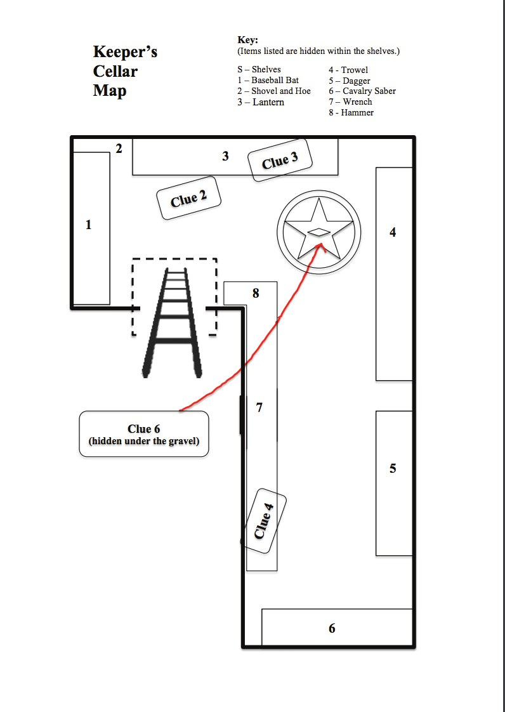

## Карта погреба для Хранителя

**Ключ к карте** (перечисленные предметы спрятаны на полках):

| Метка | Что там |
|---|---|
| S | Полки (Shelves) |
| 1 | Бейсбольная бита |
| 2 | Лопата и мотыга |
| 3 | Фонарь |
| 4 | Садовый совок |
| 5 | Кинжал |
| 6 | Кавалерийская сабля |
| 7 | Гаечный ключ |
| 8 | Молоток |
| Clue 2 | Улика вторая: лестница уходит в пол |
| Clue 3 | Улика третья: старая коробка |
| Clue 4 | Улика четвёртая: альбом с вырезками (на полке) |
| Clue 6 | Улика шестая (спрятана под гравием): красная стрелка ведёт к кругу со звездой — тайному знаку на полу |

*Пунктирный прямоугольник над лестницей — люк из гостиной.*
