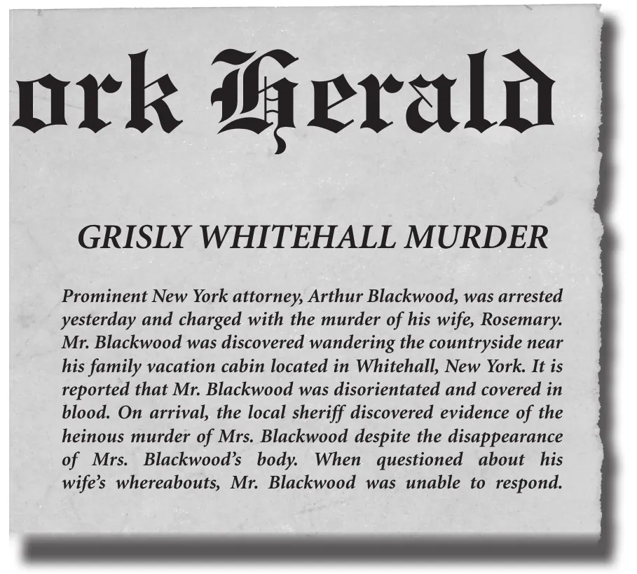
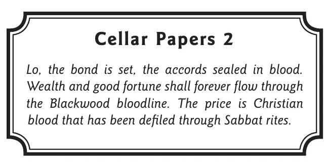
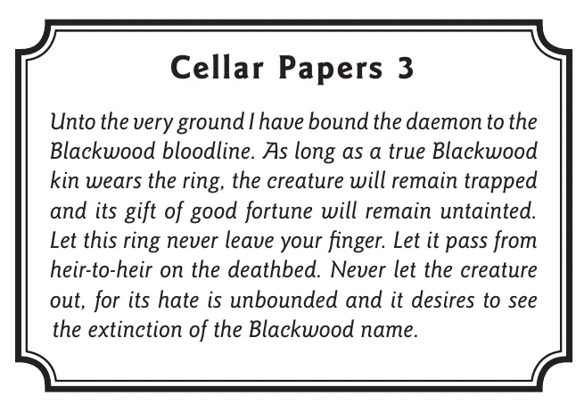

# Приложение A. Раздатка

*Ниже — каждая раздатка в оригинале (для печати) и её перевод.*

> **Раздатка «Погреб» 1**
>
> **…орк Геральд**
>
> **ЖУТКОЕ УБИЙСТВО В УАЙТХОЛЛЕ**
>
> Видный нью-йоркский адвокат Артур Блэквуд вчера арестован и обвинён в убийстве своей жены Розмари. Мистера Блэквуда обнаружили бредущим по округе близ летнего домика его семьи в Уайтхолле, штат Нью-Йорк. Сообщается, что мистер Блэквуд был дезориентирован и весь в крови. Прибыв на место, местный шериф обнаружил следы чудовищного убийства миссис Блэквуд, хотя тело миссис Блэквуд пропало. На вопрос, где находится его жена, мистер Блэквуд ответить не смог.

> **Раздатка «Погреб» 2**
>
> *Итак, связь установлена, договор скреплён кровью. Богатство и удача вовек будут течь в роду Блэквудов. Цена — христианская кровь, осквернённая обрядами шабаша.*

> **Раздатка «Погреб» 3**
>
> *Самой землёй я привязал демона к роду Блэквудов. Пока истинный родич Блэквудов носит кольцо, тварь останется в заточении, а её дар удачи пребудет незапятнанным. Да не покинет это кольцо твоего пальца. Да переходит оно от наследника к наследнику на смертном одре. Никогда не выпускай тварь, ибо ненависть её безгранична и она жаждет увидеть, как угаснет имя Блэквудов.*
