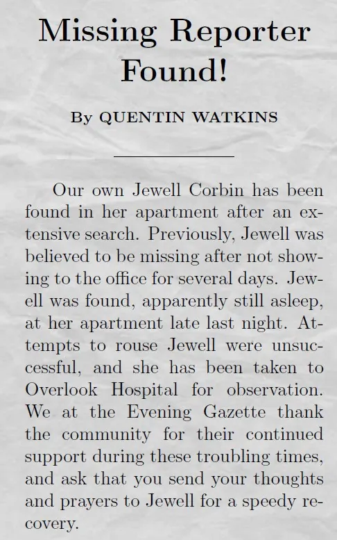
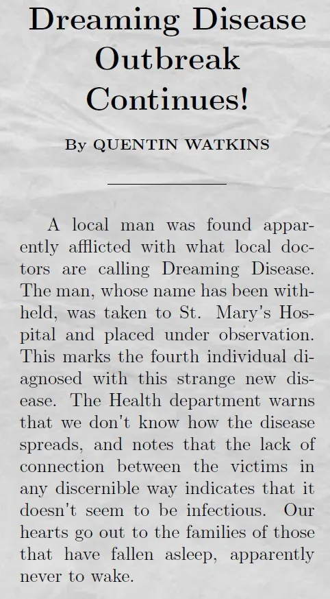

# Раздатка

*Ниже — каждая раздатка в оригинале (картинкой, для печати, где она в книге картинкой) и её перевод.*

## Раздатка 1

> **Раздатка «Старфолл» 1**
>
> **Пропавшая журналистка найдена!**
>
> *Квентин Уоткинс*
>
> Нашу коллегу Джуэлл Корбин после долгих поисков нашли в её квартире. Прежде считалось, что Джуэлл пропала: несколько дней она не появлялась в редакции. Вчера поздно вечером Джуэлл нашли в её квартире — по-видимому, всё ещё спящей. Разбудить Джуэлл не удалось, и её отвезли под наблюдение в больницу «Оверлук». Мы, сотрудники «Ивнинг газетт», благодарим горожан за неизменную поддержку в эти тревожные времена и просим вас мысленно и в молитвах пожелать Джуэлл скорейшего выздоровления.

## Раздатка 2

> **Раздатка «Старфолл» 2**
>
> **Вспышка болезни сновидений продолжается!**
>
> *Квентин Уоткинс*
>
> Местного жителя нашли, по всей видимости, поражённым тем, что местные врачи называют болезнью сновидений. Мужчину, чьё имя не разглашается, отвезли в больницу Святой Марии и поместили под наблюдение. Это уже четвёртый человек, которому поставили диагноз этой странной новой болезни. Департамент здравоохранения предупреждает, что неизвестно, как распространяется болезнь, и отмечает, что отсутствие какой-либо заметной связи между жертвами указывает: болезнь, по-видимому, не заразна. Мы всем сердцем сочувствуем семьям тех, кто уснул и, по-видимому, уже никогда не проснётся.

## Раздатка 3

> **Раздатка «Старфолл» 3**
>
> **Выдержки из дневника Эдварда**
>
> *«…Мне начали сниться странные новые сны о фантастических мирах. Причудливые, прекрасные, жуткие существа шествуют по прекрасной и странной земле. Я никогда не был художником, но теперь хочу им стать. Если бы я мог нарисовать то, что вижу, я был бы богачом, настоящим богачом».*
>
> *«С каждой ночью я всё ближе к тёмному городу. Я не хочу туда идти. Я не могу вырваться из-под его власти…»*
>
> *«Я прошёл ворота Старфолла… Боюсь, в следующий раз я увижу, что там внутри».*

## Раздатка 4

> **Раздатка «Старфолл» 4**
>
> **Пачка сигарет «Лаки Стар»**
>
> По кругу: LUCKY STAR CIGARETTE COMPANY (сигаретная компания «Лаки Стар»)
>
> [в центре — перевёрнутая красная звезда]
>
> Внизу: «Старсайд»
