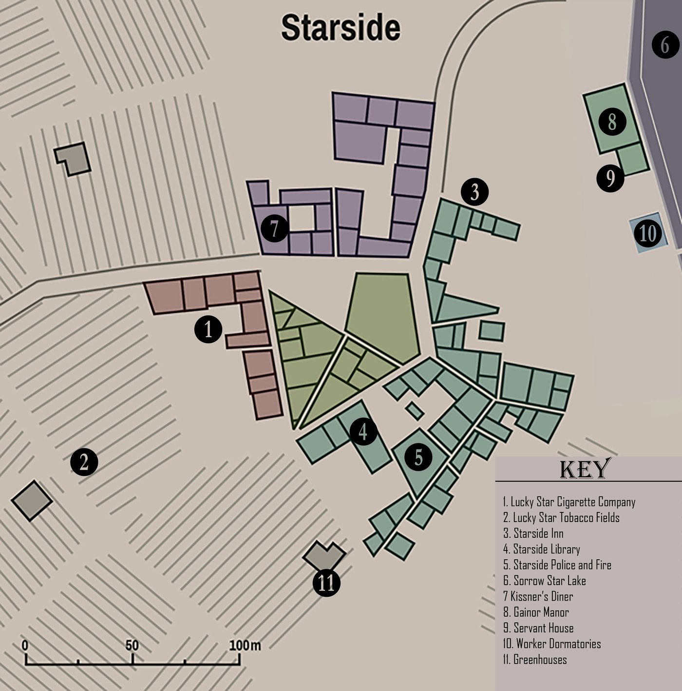

# Карта Старсайда для Хранителя

*Надпись на карте: «Starside» — Старсайд. Масштаб: 0–50–100 м.*

**Ключ**

| № | Место |
|---|---|
| 1 | Сигаретная компания «Лаки Стар» |
| 2 | Табачные поля «Лаки Стар» |
| 3 | Мотель «Старсайд-инн» |
| 4 | Библиотека Старсайда |
| 5 | Полиция и пожарная часть Старсайда |
| 6 | Озеро Печальной Звезды |
| 7 | Закусочная Кисснера |
| 8 | Особняк Гейноров |
| 9 | Дом прислуги Гейноров |
| 10 | Общежитие рабочих Гейнора |
| 11 | Теплицы «Лаки Стар» |

*Прим. перев.: на карте номер 11 стоит у одной теплицы, хотя теплиц на полях несколько.*
