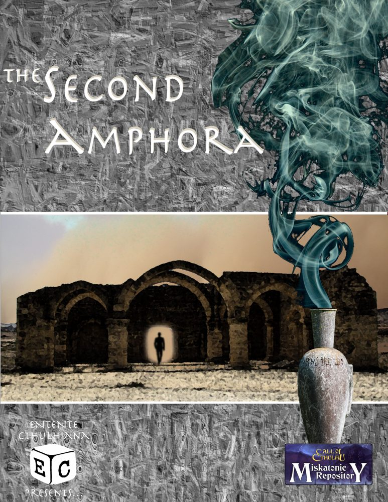

ВТОРАЯ АМФОРА

Энрике Камино

*На обложке — название «The Second Amphora»; ниже — руины арочного здания в пустыне, в светлом проёме — тёмная фигура человека; справа — амфора с надписью у горлышка, из неё поднимается зеленоватый дым. Внизу — логотип Entente Cthulhiana («Entente Cthulhiana представляет…») и логотип «Call of Cthulhu — Miskatonic Repository».*
