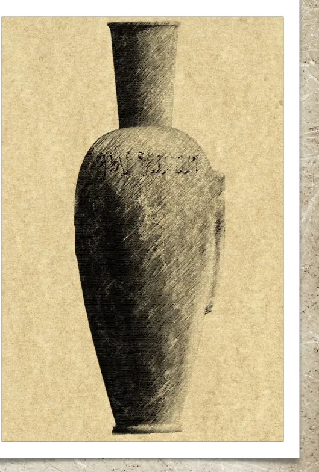

## Штурм

Балтимор, штат Мэриленд. 2 октября 2018 года, 10:28 утра.

Сыщики присоединяются к бойцам спецназа (SWAT — Special Weapons And Tactics, штурмовая группа полиции), которые вот-вот начнут штурм квартиры. Сейчас сыщики в коридоре жилого дома, где нет ничего особенно примечательного, кроме явной запущенности. По обе стороны двери выстроились человек двенадцать бойцов в тактическом снаряжении. Сыщики — в своей обычной одежде (хороший момент спросить игроков, во что одеты их сыщики и как они выглядят), и ещё на них неудобные тяжёлые чёрные бронежилеты с надписью «POLICE» поперёк крупными белыми печатными буквами. Если это подходит их профессии, они могут быть вооружены пистолетами или револьверами (более крупное оружие — только у штурмовой группы; сыщики вооружены лишь для собственной безопасности и ни в коем случае не участвуют в самом штурме).

Цель операции — арестовать участников сети торговцев древностями и изъять ценности, которые могут оказаться у них.

Спросите игроков, как себя чувствуют их сыщики. Волнуются ли они? Участвовали ли уже в подобных операциях? Знают ли кого-нибудь из бойцов? Помнят ли какой-нибудь подобный штурм, который пошёл не так? Думают ли о какой-то особой мере безопасности или приёме, которому их учили…? Строго говоря, сыщики участвуют в роли консультантов (по своим профессиям). Достаточно, чтобы полиция пригласила одного из сыщиков, — этим объяснится присутствие остальных: первый попросил их себе в помощь.

Настоящая цель сыщиков, помимо сотрудничества с властями, — найти определённую амфору, которая, по их сведениям, может быть в этой квартире. Они никогда её не видели, у них есть только эскиз (копия — рядом с этим абзацем, ещё одна — в конце книги, как раздатка). Амфора охряного цвета, у горлышка её опоясывает надпись, горлышко запечатано воском, высота — примерно 1,5 метра (5 футов).

Полицейские входят. Сыщики остаются позади. Кто-то выкрикивает приказы. Слышатся выстрелы, что-то бьётся.

Но неразбериха длится недолго. Войдя, сыщики видят араба в традиционной одежде: он лежит на полу с огнестрельной раной в груди. Бойцы сообщают по рации, что они внутри и помещение под контролем. Один из бойцов, приложив пальцы к горлу лежащего, подтверждает, что тот мёртв. Штурмовая группа уходит, чтобы сыщики могли «заняться своим делом». Через несколько минут придут ещё люди и помогут с описью.

Оставшись одни, сыщики оказываются в сравнительно небольшой квартире, полной картонных и деревянных ящиков и небольших вещиц арабского стиля всех видов и форм. Некоторые предметы, кажется, выставлены напоказ — или, может быть, их вынули из ящиков, чтобы оценить, почистить или отреставрировать.

