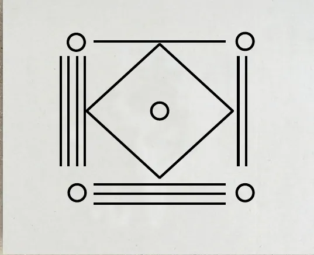

- Фотография двухэтажного загородного дома, снятая снаружи; вокруг деревья и опавшие бурые и оранжевые листья (копия — на с. 10, ещё одна — в конце книги, как раздатка).
- Дорожная карта окрестностей Гротона (Вермонт) с рукописными пометками, как доехать до уединённого дома в лесистой местности. Место назначения — в малонаселённой местности, на склоне холма, недалеко от озера. Любой поисковик или картографическое приложение подтвердит, что дорога туда займёт 8–9 часов на машине. (Если сыщики проверят другие виды транспорта, окажется, что машина и правда быстрее всего: с авиарейсами всё совсем не просто.)
- Листок с непонятным рисунком из нескольких кругов и линий (набросок — рядом с этими строками, копия — в конце книги, как раздатка).
- Распечатка с несколькими датами: между каждой и следующей ровно четыре года, а последняя — через два дня после сегодняшнего. Если хотите использовать её как раздатку, можете сделать документ сами. (Если вы берёте предложенные в сценарии даты, последней будет 4 октября 2018 года, поскольку «сегодня» — 2 октября.)
- Листок-стикер с рукописной надписью «Aden2018». Если хотите использовать его как раздатку, можете сделать его сами.

## Приказ

Если сыщики обсудят всё это со своим начальством, приказ будет таков: во-первых, прислать фотографии всего, что они нашли, а во-вторых, съездить в дом, отмеченный на карте, и, если там найдётся вторая амфора (как будто намекает предупреждение умирающего), охранять её в доме до приезда специалиста. Специалист должен прибыть туда через день-два.

## О доме

Если сыщики догадаются попросить навести справки об этом месте, позже в тот же день, пока они в дороге, им приходит зашифрованное письмо со следующими сведениями:

> **Раздатка «Зашифрованное письмо о доме»**
>
> Дом построен в 2010 году и принадлежит импортно-экспортной компании, торгующей с Саудовской Аравией, — «Арабимпо, Инк.»; прежде компания базировалась в Адене (Йемен), теперь — в Эр-Рияде (Саудовская Аравия). У компании небольшое торговое представительство в Балтиморе (США), в офисном здании (компания платит за стационарный телефон, за человека, который принимает сообщения, и за доступ к переговорной, если она когда-нибудь понадобится, но это не настоящее рабочее место, и прямых сотрудников там нет).

> **Как распоряжаться временем**
>
> *Мы не можем предвидеть, в каком порядке ваши игроки найдут каждую улику и как долго они будут общаться друг с другом или обсуждать, что предпринять, поэтому распоряжаться временем — в ваших руках.*
>
> *В любом случае, по мере развития сценария, и особенно когда сыщики окажутся в доме, важно постоянно давать им понять, что ветер снаружи всё время неуклонно усиливается. В какой-то момент их напугает стук ветвей дерева в окна. Позже, когда солнце начнёт садиться (или когда вы сочтёте момент подходящим), они увидят, как буря поднимает вихри листьев.*
