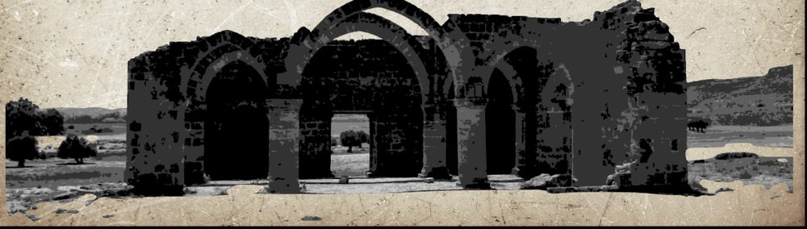

## Первое видение

Поскольку дорога до дома занимает несколько часов, у группы, по сути, два варианта: переночевать в придорожном мотеле или вести машину по очереди и спать в ней. В любом случае это время можно использовать, чтобы ввести сцену, описанную ниже. Если кто-то из сыщиков настаивает, что всю ночь будет вести машину один (мы бы не советовали такой вариант: на следующий день он будет слишком усталым, чтобы как следует «работать»), и нет никакого — тонкого — способа его переубедить, просто сыграйте сцену с остальными. Важные сведения дойдут до этого сыщика позже, когда остальные поделятся тем, что видели во сне.

Если группа устроится так, что никто вообще не спит между находкой первой амфоры и прибытием в дом, используйте это видение как галлюцинацию и введите его для каждого сыщика по отдельности. Например, когда они впервые увидят дом, ещё до того, как войдут.

Эта сцена — сон (или галлюцинация), который видит каждый сыщик. Хотя для всех он (почти) одинаков, советуем играть его с каждым по отдельности, чтобы посеять некоторое замешательство (и подозрения). Можете прочитать или пересказать следующий текст:

*Ты выходишь из шатра. Только что наступила ночь, и ты пробуешь чай, наслаждаясь бескрайностью пустыни. Твой верблюд, лёжа на земле, жуёт какие-то корни и рассеянно ревёт.*

*Завтра ты должен добраться до перекрёстка, до древних руин, и встретить остальных избранных, как предсказано в пророчестве. Наконец-то ты чувствуешь, что вот-вот достигнешь конца долгого пути. Всего один день, хотя ночное небо говорит тебе, что завтра будет буря…*

Если окажется, что каждый «настоящий» (читай: «современный») сыщик родом из разных концов света (как готовые сыщики в конце книги — и как мы советуем, если создаёте новых), можно добавить это сюда: *«Ты много дней путешествуешь с севера/юга/востока/запада…»*

Самая последняя фраза сна у каждого сыщика своя, потому что каждый несёт свою стихию. Если игроков меньше четырёх, раздайте им стихии в указанном ниже порядке, а последнюю (последние) пропустите.

Первый сыщик: *Ты ещё раз отпиваешь чай и поглаживаешь склянку, полную воды, которую тебе велели нести.*

Второй сыщик: *Ты ещё раз отпиваешь чай и поглаживаешь мешочек, полный земли, который тебе велели нести.*

Третий сыщик: *Ты ещё раз отпиваешь чай и поглаживаешь маленькую запечатанную амфору, которую тебе велели нести; она такая лёгкая, что можно подумать, будто она пуста.*

Четвёртый сыщик: *Ты ещё раз отпиваешь чай и поглаживаешь лакированную шкатулку, в которой несёшь огниво и трут, которые тебе велели нести.*

Скорее всего, игроки вас перебьют и потребуют объяснить, как это вяжется со всем, что они делали до сих пор. Отвечайте сухо: вот что они сейчас видят и делают, а их сыщики таких вопросов не задали бы, потому что знают, кто они такие. Единственный вопрос, на который можно ответить, — «где я?»: они недалеко от Адана (Адан — древний вариант названия Аден; так его назвали бы эти персонажи). Пусть это останется не более чем интерлюдией из сна (в конце концов, это именно она и есть). Проснувшись снова в знакомой им реальности, сыщики легко решат, что это был просто сон.

