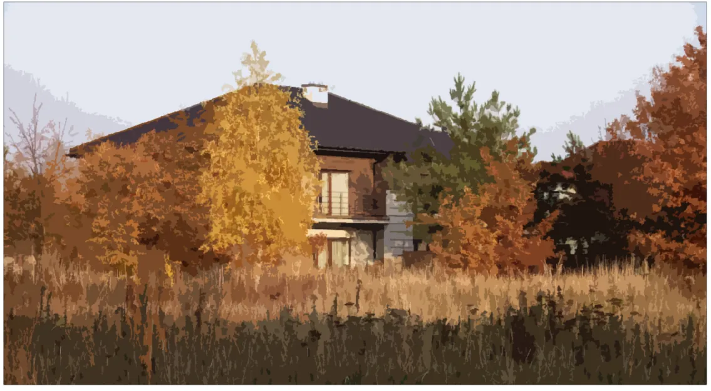

## Дом в лесу

Поездка до места, отмеченного на карте, занимает несколько часов. По мере приближения и навигатор, и связь в телефонах пропадают всё чаще. Последние километры (или мили — как вам больше нравится) приходится то и дело сверяться с рукописными пометками на карте из камеры хранения: ни на одном устройстве связи больше нет вовсе. Внимание, которое сыщики прежде уделяли экранам, теперь требуют карта и окрестности. Вдоль дорог тянутся бесконечные красные и оранжевые деревья, а толстый ковёр опавших листьев скрывает некоторые развилки, так что группе приходится сверяться с картой и даже время от времени возвращаться назад. К счастью, дорог вокруг не так уж много, и найти дом в конце концов не так уж трудно.

Выйдя из машины, сыщики чувствуют, что ветерок чуть сильнее, чем было бы приятно. В остальном дом выглядит точь-в-точь как на фотографии. Похоже, снимок сделан спереди — примерно оттуда, где сейчас стоят сыщики. Единственное отличие — охранная ограда по всему периметру, между зданием и сыщиками. Это металлическая сетка с ромбовидными ячейками, натянутая через равные промежутки на бетонные столбы высотой 1,80–2,00 метра (6–7 футов). Перед главным входом — запертые двустворчатые чёрные металлические ворота, которые можно открыть, чтобы впустить машины.

На дороге к воротам тоже полно опавших листьев — и внутри участка, и снаружи, — так что любой решил бы, что машины сюда давно не приезжали. Поблизости нет ни одной машины и ничего, что навело бы на мысль, что в доме кто-то живёт.

У входа — домофон с камерой наблюдения. Нажатие на кнопку ничего не даёт. Если сыщики продолжат нажимать, они заметят, что при нажатии не слышно никакого электрического гудения. На одном из углов фасада — камера наблюдения побольше, направленная на ворота. Если присмотреться, на ней нет никакого светодиода, по которому можно было бы понять, работает ли она, и она не поворачивается вслед за сыщиками, когда те передвигаются (на самом деле она сейчас выключена, но с того места, где они стоят, удостовериться в этом нельзя).

