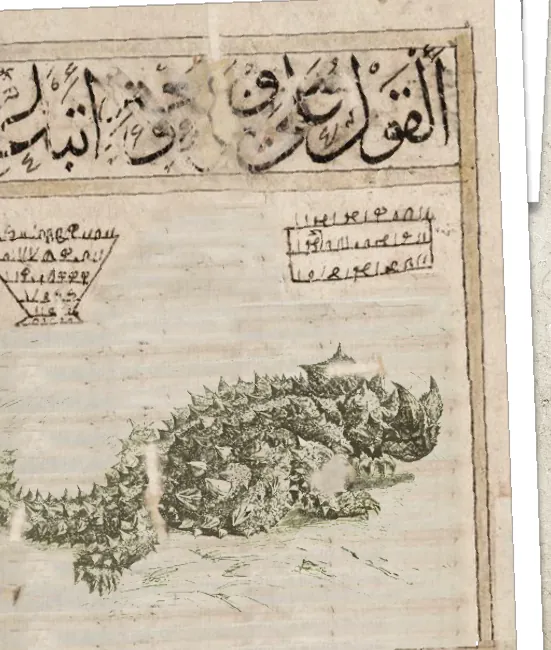

Ещё один предмет, который привлекает здесь внимание сыщиков, — затейливый кинжал с оранжево-жёлтым, почти прозрачным клинком, в запертой стеклянной витрине. Маленький замок легко вскрыть тому, у кого есть хоть начальные навыки, — или можно разбить стекло… (Возможно, вам захочется вспомнить об этом позже…)

Письменный стол — из тёмного дерева, богато украшенный (вообще всё в этом доме кричит о деньгах); при нём деревянный стул с мягкой обивкой и не слишком современный настольный компьютер.

При включении компьютер показывает заставку с запросом пароля. Надеемся, теперь ваши игроки вспомнят про стикер из камеры хранения: «Aden2018». Если они не свяжут одно с другим, можно воспользоваться подсказкой, которую предлагает компьютер, чтобы напомнить пароль. Если щёлкнуть по ней, подсказка такая: «Город и год».

Компьютер не подключён к интернету, программ на нём установлено немного. Просто немного покопавшись (проверка не нужна), сыщики находят следующее:

- Сразу после заставки, когда рабочий стол полностью загрузится, в правом верхнем углу экрана мигает напоминание о событии, которое состоится завтра (4 октября). Название — «Церемония». Если открыть подробности записи в календаре, видно, что это повторяющееся событие — каждые четыре года, 4 октября, начиная с 2010 года. (Заглянув в панель управления или в лицензии программ, можно выяснить, что компьютер куплен в 2009 году, — этим может объясняться, почему нет сведений о событиях или задачах до этого года.)
- Кроме значков программ, установленных вместе с операционной системой, есть значок, запускающий программу для просмотра DVD.
- В меню «Недавние документы» перечислено несколько файлов:

1\. Черновик какого-то инженерного проекта с описанием того, что нужно для устройства подъёмной платформы, включая примерные размеры и вес и список деталей, необходимых для постройки механизма. Если кто-нибудь из
