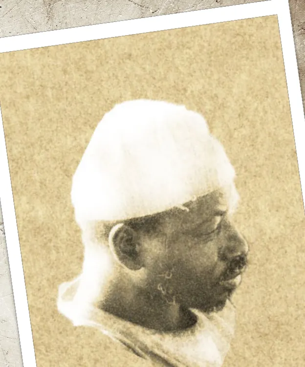

игроков прямо спросит про квадратный участок опущенного пола в главной комнате — да, размер платформы мог бы совпадать с размером этого участка. Или же можете сообщить им, что участок опущенного пола в главной комнате примерно того же размера, что и описанная там платформа, — «для сравнения». Это должно навести их на верный след.

2\. Электронная таблица, в которой перечислено большинство деталей, указанных в предыдущем файле как необходимые для постройки платформы.

3\. Электронная таблица с названиями разных компаний (судя по названиям, все они строительные или инженерные), датами и ценами.

Если сравнить содержимое файлов, похоже, что третий — это план или смета постройки сооружения, описанного в первом, из деталей, перечисленных во втором.

Если запустить проигрыватель DVD, в меню видно, что последние открывавшиеся файлы названы датами: 4 октября 2014 года и 4 октября 2010 года.

В письменном столе несколько ящиков, один из них заперт. Открыть его поможет удачное применение Взлома или достаточная сила. В ящике — два DVD-диска с написанными от руки датами. На дисках — видеозаписи, каждая примерно по 2 часа. Даты:

- 4 октября 2010 года
- 4 октября 2014 года

Первая запись (2010) показывает тёмную комнату (а может быть, это где-то под открытым небом — трудно сказать, потому что темнота скрывает места, где были бы стены… но гладкий цементный пол наводит зрителей на мысль, что это помещение внутри здания). Изображение на записи есть, звука нет. Четыре человека арабской внешности стоят, образуя квадрат, а пятый, явно старше остальных (из-за угла съёмки его лица не видно), сидит среди них. Тусклый желтоватый свет, от которого мерцают тени, похоже, исходит от факелов или от костра.

Кроме людей, видна какая-то резная каменная аркада. Все они участвуют в каком-то обряде: человек в центре напевает, а остальные вступают после каждого стиха. Полное описание обряда — в разделе о втором видении (с. 18). Запись заканчивается тем, что ведущий обряда воском запечатывает горлышко амфоры, похожей на те, что сыщики уже видели.

Вторая запись очень похожа на первую, но здесь камеру переставили в другое место, и теперь видно то, что раньше было скрыто. Человек, сидящий в центре, находится перед двумя амфорами (их ведь не нужно описывать, правда?). Кроме того, примерно на 20-й минуте кое-что отличается от обряда 2010 года.

Когда ведущий обряда бросает что-то в огонь и пять огней словно становятся зелёными, на этой записи один из
