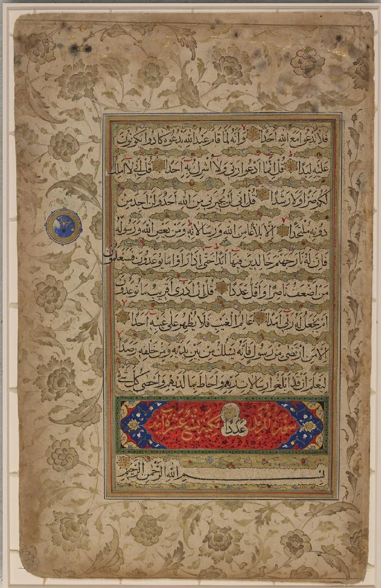

*Чтобы воск печати поистине усыпил джинна и не дал ему бежать, его нужно приготовить в горячей чаше, окружённой водой, землёй, воздухом и огнём. Лишь так всё, чего страшится джинн, — запретное ему вещественное бытие — будет присутствовать в печати. Тело надлежит сжечь, а прах собрать в амфору-близнеца по тому же обряду, ибо одно сердце годно оживить лишь одно тело, и, разделив их, воздвигают две преграды возвращению джинна.*

*А поскольку воск — вещь мирская и, как люди и звери, со временем умирает, обряд следует повторять по прошествии времени, дабы печать не утратила силы и джинн, хотя бы призраком, не вырвался из темницы и не бродил свободно, обманывая и преследуя других.*

