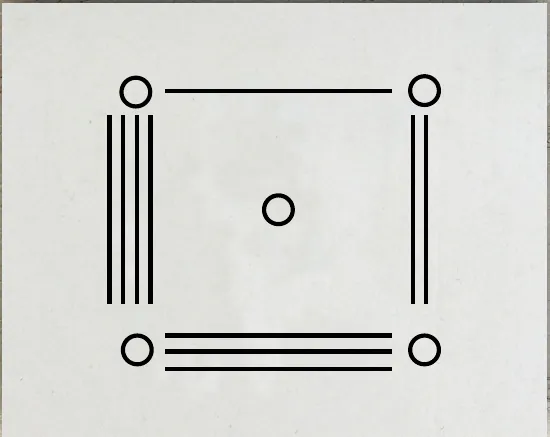
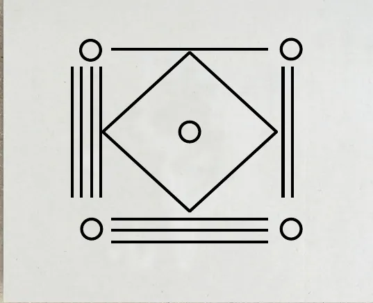
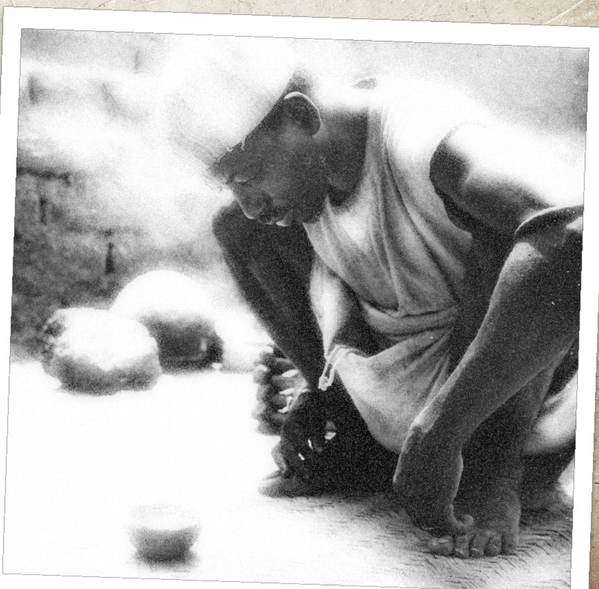

> **Раздатка «Неполная схема на песке»**
>
> Это схема, которую мудрец чертит на песке. Если сравнить её со схемой справа, не хватает ромба, вписанного в квадрат.
>
> Сыщики должны дополнить схему, чтобы доказать, что они избранные. (На листке, найденном в камере хранения, — полная схема.)

