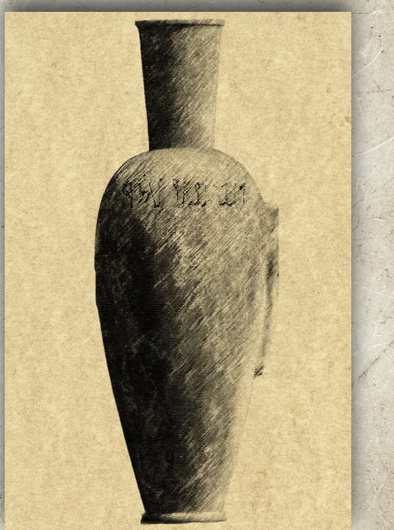

# Раздатка

**Оговорка**

Автор не говорит по-арабски и не умеет читать ни арабское, ни набатейское письмо, поэтому он почти уверен, что текст на раздатках не связан напрямую с сюжетом. Примите, пожалуйста, мои смиренные извинения.

> **Раздатка «Эскиз амфоры»**
>
> Эскиз амфоры, которую должны найти сыщики.
>
> *См.: с. 6.*
