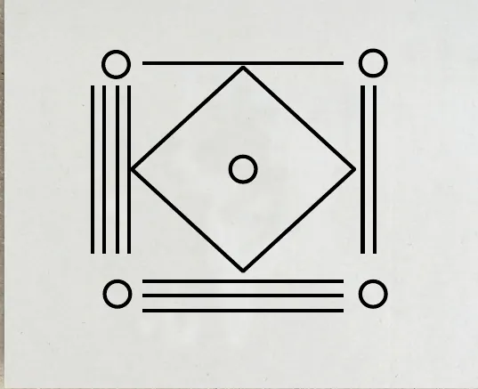
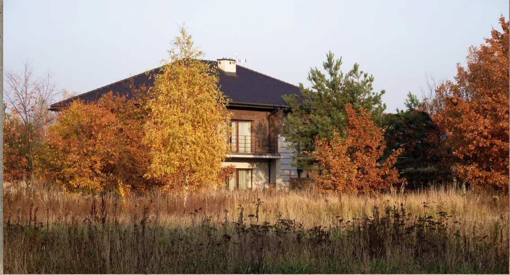

> **Раздатка «Странная схема»**
>
> Странная схема и фотография дома. Часть содержимого ячейки 314 в камере хранения.
>
> *См.: с. 8.*

<!-- -->

> **Раздатка «Фотография дома в лесу»**
>
> Фотография дома из ячейки 314 в камере хранения (подпись к ней — общая со «Странной схемой» выше).
