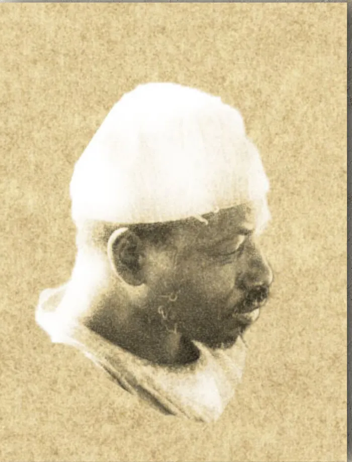
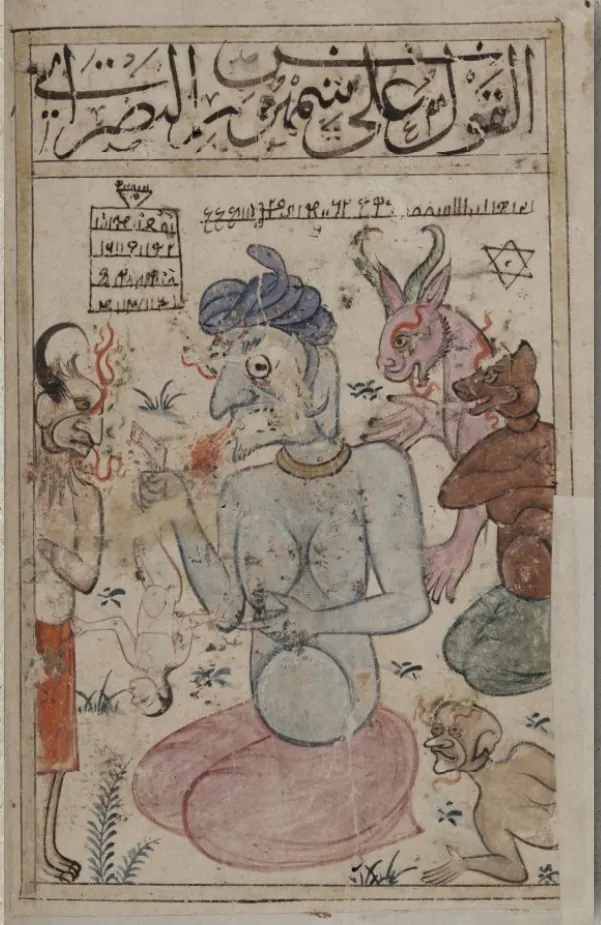

*На странице оригинала обе картинки повёрнуты на 90°; здесь выпрямлены.*

> **Раздатка «Рисунок углём: голова старика»**
>
> Гравюры на стенах библиотеки (продолжение; см. с. 12).

<!-- -->

> **Раздатка «Гравюра с арабскими демонами»**
>
> Гравюры на стенах библиотеки (продолжение; см. с. 12).
