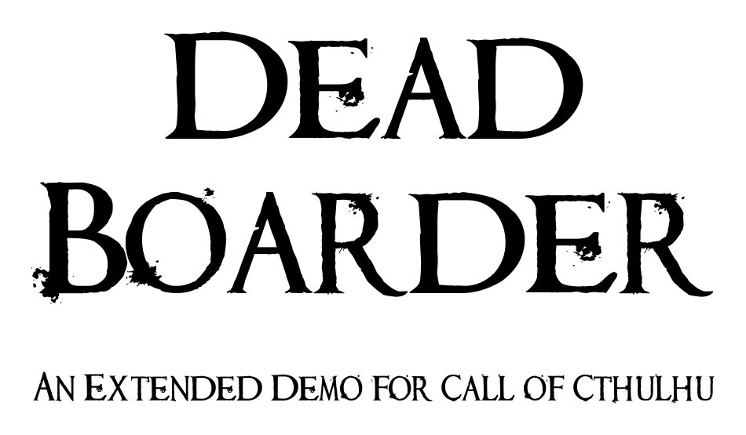

МЁРТВЫЙ ЖИЛЕЦ

Расширенная демонстрационная игра для «Зова Ктулху»

*Обложка — только надпись на белом фоне: «Dead Boarder» («Мёртвый жилец») и подзаголовок «An Extended Demo for Call of Cthulhu» («Расширенная демонстрационная игра для „Зова Ктулху“»); иллюстрации нет.*
