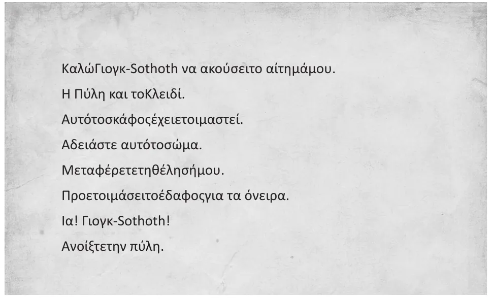
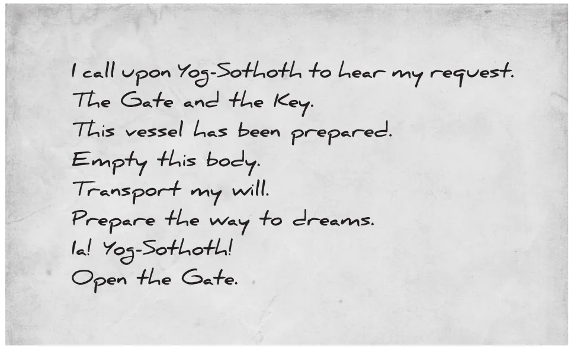

> **Раздатка 1** (текст для игроков — на греческом, как напечатано)
>
> ΚαλώΓιογκ-Sothoth να ακούσειτο αίτημάμου.  
> Η Πύλη και τοΚλειδί.  
> Αυτότοσκάφοςέχειετοιμαστεί.  
> Αδειάστε αυτότοσώμα.  
> Μεταφέρετετηθέλησήμου.  
> Προετοιμάσειτοέδαφοςγια τα όνειρα.  
> Ια! Γιογκ-Sothoth!  
> Ανοίξτετην πύλη.

*Прим. перев.: так в оригинале — в греческом тексте пропущены пробелы между словами, а «Sothoth» набрано латиницей. Перевод смысла — раздатка 2.*

> **Раздатка 2**
>
> *Взываю к Йог-Сототу: услышь мою просьбу.*  
> *Врата и Ключ.*  
> *Этот сосуд приготовлен.*  
> *Опустоши это тело.*  
> *Перенеси мою волю.*  
> *Приготовь путь к снам.*  
> *Йа! Йог-Сотот!*  
> *Открой Врата.*
