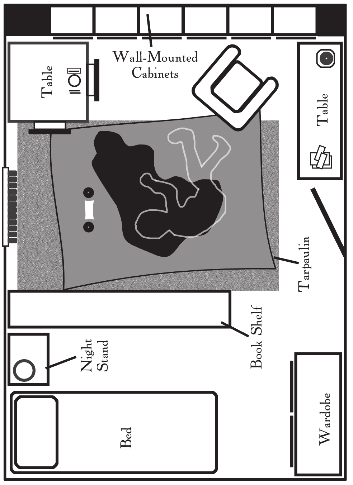

# Карта: комната Гардинера

**Подписи на карте:**

| На карте | Перевод |
|---|---|
| Wall-Mounted Cabinets | Шкафчики на стене |
| Table (в левом верхнем углу) | Стол (маленький столик с двумя стульями) |
| Table (у правой стены) | Стол (длинный стол у двери) || Tarpaulin | Брезент |
| Book Shelf | Книжный шкаф |
| Night Stand | Тумбочка |
| Bed | Кровать |
| Wardobe | Платяной шкаф |
| Map: Gardiner’s Room | Карта: комната Гардинера |

*Прим. перев.: так на карте — «Wardobe» вместо «Wardrobe». Без подписей на карте нарисованы мягкое кресло (вверху, у шкафчиков), окно (на левой стене), дверь в коридор (на правой стене, между столом и брезентом) и тело на брезенте (контур).*
