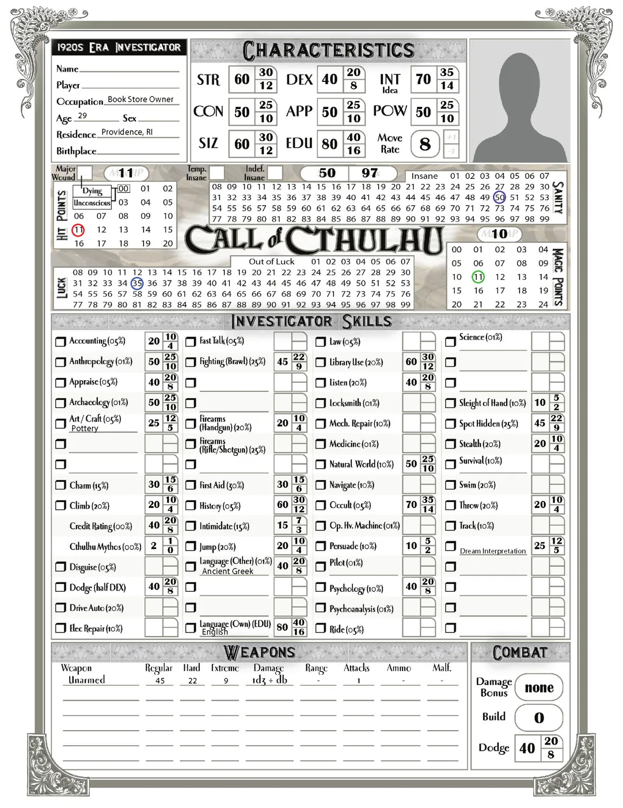

# Лист сыщика: Владелец (владелица) книжной лавки

*Лист сыщика 1920-х годов (1920s Era Investigator); вместо портрета — силуэт. Ниже — данные листа переводом.*

| Поле листа | Значение |
|---|---|
| Имя | — (имя и пол выбирает игрок) |
| Игрок | — |
| Профессия | владелец (владелица) книжной лавки («Book Store Owner») |
| Возраст | 29 |
| Пол | — |
| Место жительства | Провиденс, Род-Айленд («Providence, RI») |
| Место рождения | — |

**Характеристики**

| СИЛ | ВЫН | ТЕЛ | ЛВК | НАР | ИНТ | МОЩ | ОБР |
|---|---|---|---|---|---|---|---|
| 60 (30/12) | 50 (25/10) | 60 (30/12) | 40 (20/8) | 50 (25/10) | 70 (35/14) | 50 (25/10) | 80 (40/16) |

| ПЗ | Рассудок | Удача | ПМ | СКО | БкУ | Комплекция | Уклонение |
|---|---|---|---|---|---|---|---|
| 11 | 50 (макс. 97) | 35 | 10 | 8 | нет | 0 | 40% (20/8) |

**Навыки** (заполненные на листе; значение, половина / пятая доля)

| Навык | Значение |
|---|---|
| Антропология | 50% (25/10) |
| Археология | 50% (25/10) |
| Ближний бой (драка) | 45% (22/9) |
| Бухгалтерское дело | 20% (10/4) |
| Внимание | 45% (22/9) |
| Естествознание | 50% (25/10) |
| Запугивание | 15% (7/3) |
| Иностранный язык (древнегреческий) | 40% (20/8) |
| Искусство/ремесло (гончарное дело) | 25% (12/5) |
| История | 60% (30/12) |
| Лазание | 20% (10/4) |
| Ловкость рук | 10% (5/2) |
| Метание | 20% (10/4) |
| Мифы Ктулху | 2% (1/0) |
| Обаяние | 30% (15/6) |
| Оккультизм | 70% (35/14) |
| Оценка | 40% (20/8) |
| Первая помощь | 30% (15/6) |
| Прыжки | 20% (10/4) |
| Психология | 40% (20/8) |
| Работа в библиотеке | 60% (30/12) |
| Родной язык (английский) | 80% (40/16) |
| Скрытность | 20% (10/4) |
| Слух | 40% (20/8) |
| Средства | 40% (20/8) |
| Стрельба (пистолет) | 20% (10/4) |
| Толкование снов («Dream Interpretation») | 25% (12/5) |
| Убеждение | 10% (5/2) |
| Уклонение | 40% (20/8) |

**Оружие**

| Оружие | Обычный | Трудный | Чрезвычайный | Урон | Дальность | Атак | Патронов | Осечка |
|---|---|---|---|---|---|---|---|---|
| Без оружия | 45 | 22 | 9 | 1d3 + БкУ | — | 1 | — | — |

**Бой:** бонус к урону: нет, комплекция 0, уклонение 40% (20/8).

*Прим. перев.: на листе пункты магии в рамке — 10 (МОЩ 50 / 5), а на шкале магии обведено 11.*

*Навык «Dream Interpretation» (толкование снов) вписан на листе в пустую строку; механики для него в сценарии нет.*
