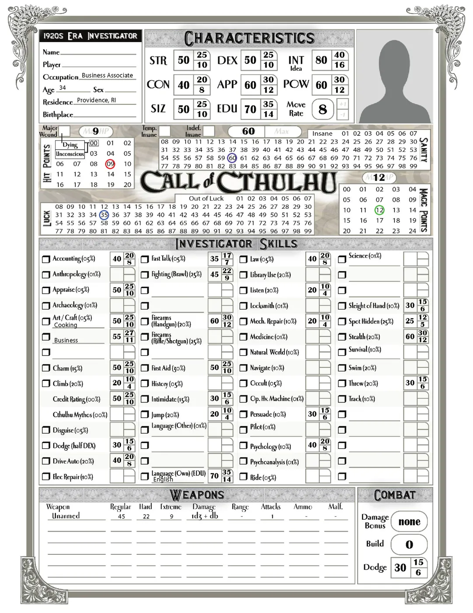

# Лист сыщика: Деловой партнёр (деловая партнёрша)

*Лист сыщика 1920-х годов (1920s Era Investigator); вместо портрета — силуэт. Ниже — данные листа переводом.*

| Поле листа | Значение |
|---|---|
| Имя | — (имя и пол выбирает игрок) |
| Игрок | — |
| Профессия | деловой партнёр (деловая партнёрша) («Business Associate») |
| Возраст | 34 |
| Пол | — |
| Место жительства | Провиденс, Род-Айленд («Providence, RI») |
| Место рождения | — |

**Характеристики**

| СИЛ | ВЫН | ТЕЛ | ЛВК | НАР | ИНТ | МОЩ | ОБР |
|---|---|---|---|---|---|---|---|
| 50 (25/10) | 40 (20/8) | 50 (25/10) | 50 (25/10) | 60 (30/12) | 80 (40/16) | 60 (30/12) | 70 (35/14) |

| ПЗ | Рассудок | Удача | ПМ | СКО | БкУ | Комплекция | Уклонение |
|---|---|---|---|---|---|---|---|
| 9 | 60 | 35 | 12 | 8 | нет | 0 | 30% (15/6) |

**Навыки** (заполненные на листе; значение, половина / пятая доля)

| Навык | Значение |
|---|---|
| Ближний бой (драка) | 45% (22/9) |
| Бухгалтерское дело | 40% (20/8) |
| Внимание | 25% (12/5) |
| Вождение автомобиля | 40% (20/8) |
| Запугивание | 30% (15/6) |
| Искусство/ремесло (коммерция) | 55% (27/11) |
| Искусство/ремесло (кулинария) | 50% (25/10) |
| Красноречие | 35% (17/7) |
| Лазание | 20% (10/4) |
| Ловкость рук | 30% (15/6) |
| Метание | 30% (15/6) |
| Механика | 20% (10/4) |
| Обаяние | 50% (25/10) |
| Оценка | 50% (25/10) |
| Первая помощь | 50% (25/10) |
| Прыжки | 20% (10/4) |
| Психология | 40% (20/8) |
| Родной язык (английский) | 70% (35/14) |
| Скрытность | 60% (30/12) |
| Слух | 20% (10/4) |
| Средства | 50% (25/10) |
| Стрельба (пистолет) | 60% (30/12) |
| Убеждение | 30% (15/6) |
| Юриспруденция | 40% (20/8) |
| Уклонение | 30% (15/6) |

**Оружие**

| Оружие | Обычный | Трудный | Чрезвычайный | Урон | Дальность | Атак | Патронов | Осечка |
|---|---|---|---|---|---|---|---|---|
| Без оружия | 45 | 22 | 9 | 1d3 + БкУ | — | 1 | — | — |

**Бой:** бонус к урону: нет, комплекция 0, уклонение 30% (15/6).

*Строка «Business» на листе стоит среди специализаций Искусства/ремесла — переведено как Искусство/ремесло (коммерция).*
