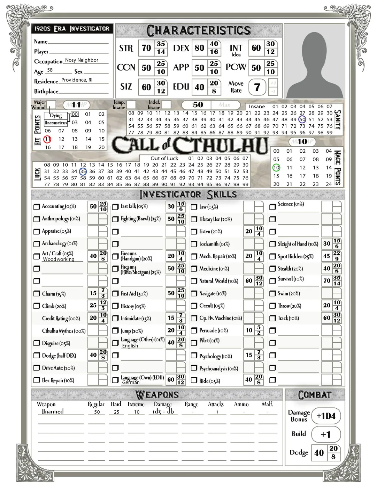

# Лист сыщика: Любопытный сосед (любопытная соседка)

*Лист сыщика 1920-х годов (1920s Era Investigator); вместо портрета — силуэт. Ниже — данные листа переводом.*

| Поле листа | Значение |
|---|---|
| Имя | — (имя и пол выбирает игрок) |
| Игрок | — |
| Профессия | любопытный сосед (любопытная соседка) («Nosy Neighbor») |
| Возраст | 58 |
| Пол | — |
| Место жительства | Провиденс, Род-Айленд («Providence, RI») |
| Место рождения | — |

**Характеристики**

| СИЛ | ВЫН | ТЕЛ | ЛВК | НАР | ИНТ | МОЩ | ОБР |
|---|---|---|---|---|---|---|---|
| 70 (35/14) | 50 (25/10) | 60 (30/12) | 80 (40/16) | 50 (25/10) | 60 (30/12) | 50 (25/10) | 40 (20/8) |

| ПЗ | Рассудок | Удача | ПМ | СКО | БкУ | Комплекция | Уклонение |
|---|---|---|---|---|---|---|---|
| 11 | 50 | 35 | 10 | 7 | +1d4 | +1 | 40% (20/8) |

**Навыки** (заполненные на листе; значение, половина / пятая доля)

| Навык | Значение |
|---|---|
| Ближний бой (драка) | 50% (25/10) |
| Бухгалтерское дело | 50% (25/10) |
| Верховая езда | 40% (20/8) |
| Внимание | 45% (22/9) |
| Выживание | 70% (35/14) |
| Естествознание | 60% (30/12) |
| Запугивание | 15% (7/3) |
| Иностранный язык (английский) | 40% (20/8) |
| Искусство/ремесло (столярное дело) | 40% (20/8) |
| Красноречие | 30% (15/6) |
| Лазание | 25% (12/5) |
| Ловкость рук | 30% (15/6) |
| Метание | 20% (10/4) |
| Механика | 20% (10/4) |
| Обаяние | 15% (7/3) |
| Первая помощь | 50% (25/10) |
| Прыжки | 20% (10/4) |
| Психология | 15% (7/3) |
| Родной язык (немецкий) | 60% (30/12) |
| Скрытность | 40% (20/8) |
| Слух | 20% (10/4) |
| Средства | 20% (10/4) |
| Стрельба (винтовка/дробовик) | 50% (25/10) |
| Стрельба (пистолет) | 20% (10/4) |
| Убеждение | 10% (5/2) |
| Чтение следов | 60% (30/12) |
| Уклонение | 40% (20/8) |

**Оружие**

| Оружие | Обычный | Трудный | Чрезвычайный | Урон | Дальность | Атак | Патронов | Осечка |
|---|---|---|---|---|---|---|---|---|
| Без оружия | 50 | 25 | 10 | 1d3 + БкУ | — | 1 | — | — |

**Бой:** бонус к урону: +1d4, комплекция +1, уклонение 40% (20/8).
