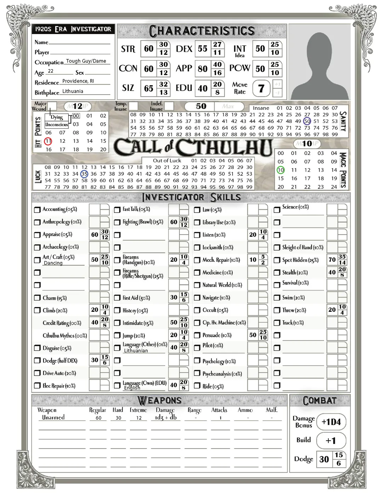

# Лист сыщика: Крутой парень (крутая дамочка)

*Лист сыщика 1920-х годов (1920s Era Investigator); вместо портрета — силуэт. Ниже — данные листа переводом.*

| Поле листа | Значение |
|---|---|
| Имя | — (имя и пол выбирает игрок) |
| Игрок | — |
| Профессия | крутой парень (крутая дамочка) («Tough Guy») |
| Возраст | 22 |
| Пол | — |
| Место жительства | Провиденс, Род-Айленд («Providence, RI») |
| Место рождения | Литва |

**Характеристики**

| СИЛ | ВЫН | ТЕЛ | ЛВК | НАР | ИНТ | МОЩ | ОБР |
|---|---|---|---|---|---|---|---|
| 60 (30/12) | 60 (30/12) | 65 (32/13) | 55 (27/11) | 80 (40/16) | 50 (25/10) | 50 (25/10) | 40 (20/8) |

| ПЗ | Рассудок | Удача | ПМ | СКО | БкУ | Комплекция | Уклонение |
|---|---|---|---|---|---|---|---|
| 12 | 50 | 35 | 10 | 7 | +1d4 | +1 | 30% (15/6) |

**Навыки** (заполненные на листе; значение, половина / пятая доля)

| Навык | Значение |
|---|---|
| Ближний бой (драка) | 60% (30/12) |
| Внимание | 70% (35/14) |
| Запугивание | 50% (25/10) |
| Иностранный язык (литовский) | 40% (20/8) |
| Искусство/ремесло (танцы) | 50% (25/10) |
| Лазание | 20% (10/4) |
| Метание | 20% (10/4) |
| Механика | 10% (5/2) |
| Оценка | 60% (30/12) |
| Первая помощь | 30% (15/6) |
| Прыжки | 20% (10/4) |
| Родной язык (английский) | 40% (20/8) |
| Скрытность | 40% (20/8) |
| Слух | 20% (10/4) |
| Средства | 40% (20/8) |
| Стрельба (пистолет) | 20% (10/4) |
| Убеждение | 50% (25/10) |
| Уклонение | 30% (15/6) |

**Оружие**

| Оружие | Обычный | Трудный | Чрезвычайный | Урон | Дальность | Атак | Патронов | Осечка |
|---|---|---|---|---|---|---|---|---|
| Без оружия | 60 | 30 | 12 | 1d3 + БкУ | — | 1 | — | — |

**Бой:** бонус к урону: +1d4, комплекция +1, уклонение 30% (15/6).

*Прим. перев.: на листе пункты здоровья в рамке — 12 ((ВЫН 60 + ТЕЛ 65) / 10), а на шкале здоровья обведено 11.*

*Так на листе: место рождения — Литва, но родной язык — английский, а литовский — иностранный.*
