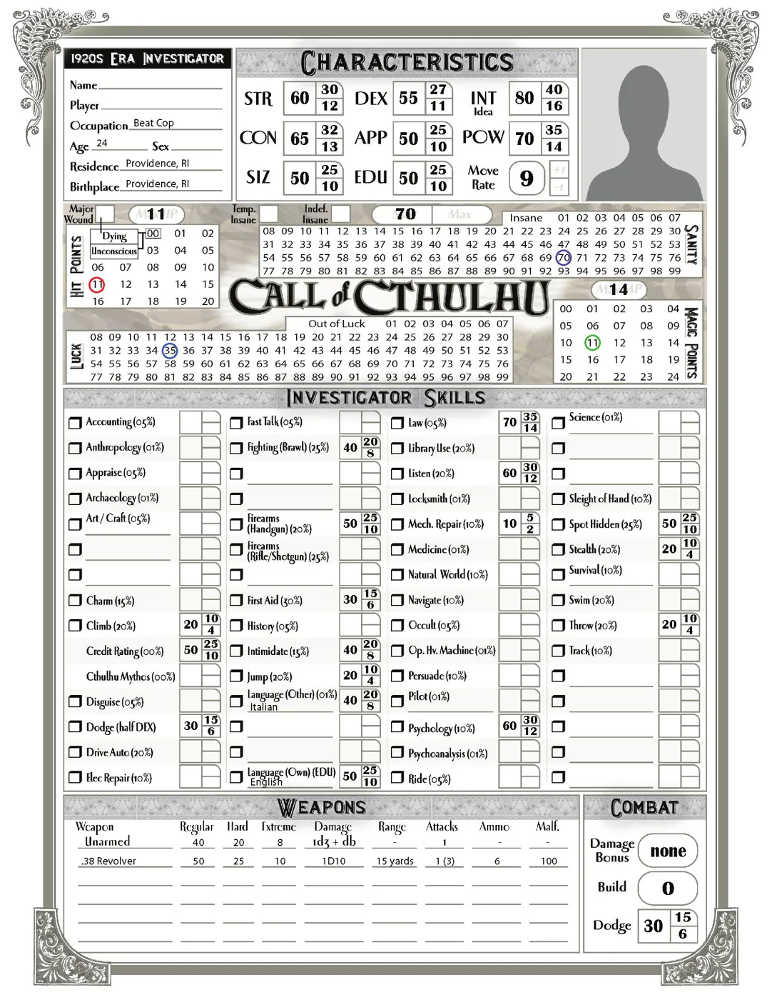

# Лист сыщика: Патрульный полицейский

*Лист сыщика 1920-х годов (1920s Era Investigator); вместо портрета — силуэт. Ниже — данные листа переводом.*

| Поле листа | Значение |
|---|---|
| Имя | — (имя и пол выбирает игрок) |
| Игрок | — |
| Профессия | патрульный полицейский («Beat Cop») |
| Возраст | 24 |
| Пол | — |
| Место жительства | Провиденс, Род-Айленд («Providence, RI») |
| Место рождения | Провиденс, Род-Айленд |

**Характеристики**

| СИЛ | ВЫН | ТЕЛ | ЛВК | НАР | ИНТ | МОЩ | ОБР |
|---|---|---|---|---|---|---|---|
| 60 (30/12) | 65 (32/13) | 50 (25/10) | 55 (27/11) | 50 (25/10) | 80 (40/16) | 70 (35/14) | 50 (25/10) |

| ПЗ | Рассудок | Удача | ПМ | СКО | БкУ | Комплекция | Уклонение |
|---|---|---|---|---|---|---|---|
| 11 | 70 | 35 | 14 | 9 | нет | 0 | 30% (15/6) |

**Навыки** (заполненные на листе; значение, половина / пятая доля)

| Навык | Значение |
|---|---|
| Ближний бой (драка) | 40% (20/8) |
| Внимание | 50% (25/10) |
| Запугивание | 40% (20/8) |
| Иностранный язык (итальянский) | 40% (20/8) |
| Лазание | 20% (10/4) |
| Метание | 20% (10/4) |
| Механика | 10% (5/2) |
| Первая помощь | 30% (15/6) |
| Прыжки | 20% (10/4) |
| Психология | 60% (30/12) |
| Родной язык (английский) | 50% (25/10) |
| Скрытность | 20% (10/4) |
| Слух | 60% (30/12) |
| Средства | 50% (25/10) |
| Стрельба (пистолет) | 50% (25/10) |
| Юриспруденция | 70% (35/14) |
| Уклонение | 30% (15/6) |

**Оружие**

| Оружие | Обычный | Трудный | Чрезвычайный | Урон | Дальность | Атак | Патронов | Осечка |
|---|---|---|---|---|---|---|---|---|
| Без оружия | 40 | 20 | 8 | 1d3 + БкУ | — | 1 | — | — |
| Револьвер .38 | 50 | 25 | 10 | 1d10 | 15 ярдов | 1 (3) | 6 | 100 |

**Бой:** бонус к урону: нет, комплекция 0, уклонение 30% (15/6).

*Прим. перев.: на листе пункты магии в рамке — 14 (МОЩ 70 / 5), а на шкале магии обведено 11.*
