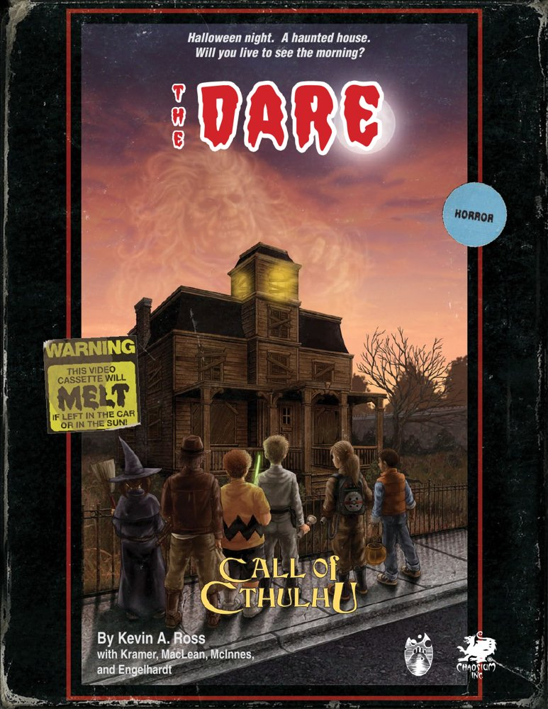

Ночь Хэллоуина. Дом с привидениями. Доживёшь ли ты до утра?

НА СПОР

Кевин Э. Росс

при участии Крамера, Маклина, Макиннеса и Энгельхардта

*Обложка оформлена как коробка видеокассеты. Наверху — «Halloween night. A haunted house. Will you live to see the morning?» («Ночь Хэллоуина. Дом с привидениями. Доживёшь ли ты до утра?») и название «The Dare» («На спор»). В закатном небе над старым домом с куполом проступает лицо старухи; у ограды стоят шестеро детей в костюмах (ведьма, искатель приключений в шляпе и кожаной куртке, мальчик в жёлтой кофте с зигзагом, «космический рыцарь» со световым мечом, девочка с рюкзаком, мальчик в жилете). Наклейки: «WARNING — This video cassette will MELT if left in the car or in the sun!» («Внимание! Эта кассета РАСПЛАВИТСЯ, если оставить её в машине или на солнце!») и «Horror» («Ужасы»). Внизу — логотип Call of Cthulhu, «By Kevin A. Ross with Kramer, MacLean, McInnes, and Engelhardt» («Кевин Э. Росс при участии Крамера, Маклина, Макиннеса и Энгельхардта»), логотипы Sentinel Hill Press и Chaosium.*
