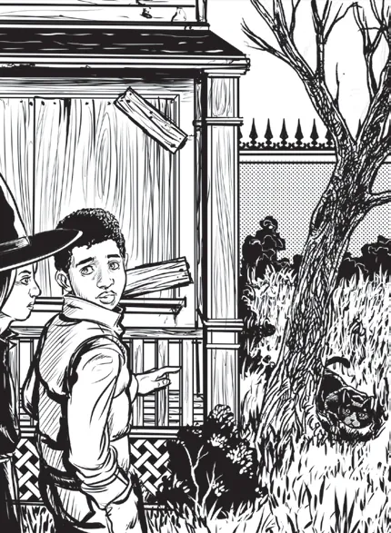

## Сарай

На заднем дворе стоит сильно покосившийся сарай: деревянные стены прогнили, толь на крыше облезает. Внутри верстаки завалены множеством ржавых инструментов (молотки, пилы, отвёртки, садовые ножницы, лопата и кирка, цепь длиной 3 м и всякая всячина). Встревоженные (или осторожные) юные сыщики легко могут подобрать здесь оружие — подробнее см. с. 5.

Успешная проверка **Чинить вещи** позволит найти несколько инструментов в рабочем состоянии. Тот, кто возьмёт их с собой, получит бонусную кость ко всем последующим проверкам **Чинить вещи**.

Проверка **Природа** позволит заметить в нескольких местах сарая безошибочные следы крыс. Любопытно, что здесь нет никаких следов других зверьков, которых обычно ожидаешь встретить в таком месте (кроме насекомых; см. «Действия Роджера» рядом), — ни бурундуков, ни кроликов, ни скунсов и так далее.

Тот, у кого навык **Играть со спичками** выше базового, обыскивая сарай, найдёт ржавую канистру керосина. С её помощью можно разводить огонь, делать факелы или провести одну атаку. Содержимое целой канистры горит 3+1d3 раунда и наносит 1d6 ПЗ урона за раунд.

> **Действия Роджера**
>
> Роджер нехотя позволит остальным осмотреть двор, заметив, что эта задержка доказывает: они такие же трусы, как он и говорил. Если они слишком долго копаются снаружи, Роджер будет донимать их всё сильнее, пока — когда сочтёт нужным Хранитель — не потребует, чтобы они шли в дом.

## Пруд

Стоячий естественный пруд прямо за домом. Вода в нём тёмная, вонючая и кажется бездонной. Любопытно, что глубина пруда даже в самом глубоком месте — не больше метра. Бóльшую часть поверхности затягивает ковёр из палых листьев вперемешку с искривлёнными чахлыми кувшинками. Лягушки квакают и поют низкими зловещими голосами. Над прудом примерно на 2,5 м нависает увитая лозой шпалера, и плети лозы свисают в воду.

Когда дети подходят к пруду, от кромки воды к дому метнулась тёмная тень. Ничего примечательного в пруду и вокруг него нет, кроме небольшой кучки потрохов на большом плоском камне у воды.

Успешная проверка **Замечать всякое** означает, что в тени можно различить большого облезлого кота, который скрывается за углом дома. Проверка **Природа** или **Школьные науки** позволит понять, что ошмётки на камне — в основном рыбьи потроха. **Версия «R»:** при успехе замечают ещё и кусок кишки длиной в несколько сантиметров… слишком большой для рыбы или другого здешнего зверька. Его, несомненно, утащили из мясной лавки. (На самом деле это один из немногих несъеденных обрывков Роджера.) Внутри копошатся личинки и вываливаются наружу, если кишку поднять.

> **Действия Роджера**
>
> **Версия «PG»:** Роджер несколько минут чистит ногти гвоздём, выдернутым из доски. Всё больше скучая, он находит банку с железками и начинает швырять их в немногие уцелевшие оконные стёкла, распевая грубую песенку о том, как кто-то пукнул. Смешно только ему. Когда дети выходят, он радостно обзывает их всех дураками за то, что тратят время снаружи.
>
> **Версия «R»:** хотя его конечная цель — привести детей к своей мерзкой хозяйке, Роджер не станет возражать, если они захотят обыскать сарай, прежде чем войти в дом. Через минуту-другую (когда сделаны проверки навыков) Роджер, оставшийся снаружи, подходит к двери с большим бумажным осиным гнездом. Прежде чем кто-нибудь успеет что-то сделать, он обеими руками разбивает его о порог. Затем отвёрткой ковыряет белых раздутых личинок внутри и неторопливо, одну за другой, лопает их, дожидаясь, пока остальные закончат. Он радостно объясняет, какие они тупые, раз тратят время на сарай: «Только дебил подумает, что тут есть хоть что-то стоящее». Когда они уже заканчивают, он находит матку, выжидает мгновение, чтобы убедиться, что все смотрят, и давит её рукояткой отвёртки. «Ну что, придурки, хватит тратить моё время?» Это маленькое представление стоит 0/1 Рассудка.
