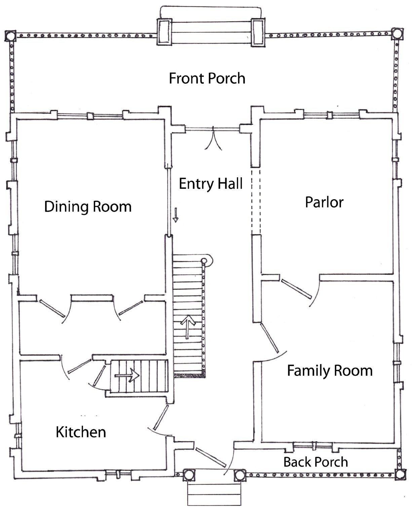

## План первого этажа

Подписи на плане:

| На плане | Перевод |
|---|---|
| Front Porch | Парадное крыльцо |
| Entry Hall | Прихожая |
| Dining Room | Столовая |
| Parlor | Гостиная для приёмов |
| Family Room | Общая комната |
| Kitchen | Кухня |
| Back Porch | Заднее крыльцо |

*Прим. перев.: на плане комната подписана «Family Room», а в тексте она называется «The Living Room» — это одна и та же общая комната.*
