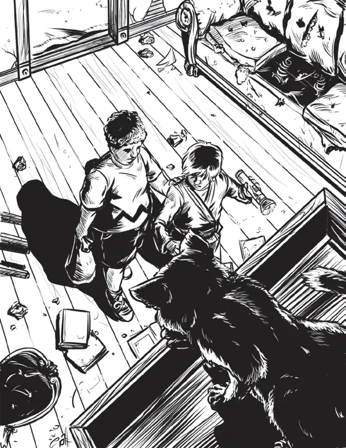

> **Действия Роджера**
>
> Если никто другой его не заметит, Роджер заберёт нож побольше. Если он увидит, как находят обгоревшую кость, Роджер будет настаивать, что это просто кость от окорока, и начнёт распевать «Dem Bones» («Косточки»), чтобы позлить остальных.

Потолок здесь испорчен медленной протечкой; чтобы это заметить, нужна трудная проверка **Замечать всякое**. Юные сыщики, которые провалятся сквозь пол в комнате над столовой, упадут на стол, и он отчасти смягчит падение. Урон от падения — 1d4+1.

*Прим. перев.: так в оригинале — «in the ROOM above»: по-видимому, вместо названия комнаты осталась незаполненная заготовка.*

## Гостиная для приёмов

Эта комната, где когда-то принимали гостей, большая и просторная, заставлена пыльными креслами и диванами, из которых лезет набивка. У южной стены — камин с резной деревянной полкой; на полку кто-то положил потрёпанный рюкзак. В камине — остатки небольшого костра из обломков стула, взятого из столовой. Судя по саже и стоящему в воздухе запаху, дымоход чем-то забит. По всей комнате валяются останки нескольких картин — почти одни сломанные рамы и изодранные холсты.

В рюкзаке — почти все пожитки Старого Дэнни, бездомного бродяги, который до недавнего времени был привычной фигурой в городке. Чей это рюкзак, станет ясно не сразу, а только когда наверху найдут его останки. Бо́льшая часть вещей юным сыщикам ни к чему (набор для шитья, несколько банок консервов), но в рюкзаке есть и кое-что интересное:

- кисет табака и папиросная бумага;
- перочинный нож (урон 1d2);
- фляжка виски на пинту (около 0,5 л);
- пачка купюр по 1 и 5 долларов (всего 104 доллара);
- несколько кусочков мела в спичечном коробке.

Если осмотреть камин, окажется, что дымоход и правда закрыт, причём довольно плотно. Его можно открыть успешной проверкой СИЛ; это делает камин безопасным, но, к несчастью, заодно из трубы в камин вываливается высохший труп енота. Вид дохлого енота стоит свидетелям 0/1d2 Рассудка (1/1d3, если туша упала на юного сыщика). Проверка **Природа** покажет, что огонь разводили в последние день-два.

Кто преуспеет в проверке **Замечать всякое** или скажет, что обыскивает комнату, найдёт под одним из диванов слегка погнутую железную каминную кочергу; она наносит 1d6 урона. Эвелин не может восстанавливаться от урона, нанесённого железом, и Роджер, если сможет, постарается завладеть кочергой и избавиться от неё, стоит юному сыщику её положить.

## Общая комната

Общая комната в лучшем состоянии, чем большинство других комнат в доме; здесь стоят диван и большой стеллаж. На его полках — десятки миниатюр и статуэток кошек, лис, птиц, оленей и других зверей из стекла и керамики. На самой верхней полке — чучело кота, большого, с блестящей сизо-серой шерстью. Это Растис, который забавляется с жертвами своей хозяйки. Он ничего не станет делать, пока его не потревожат, — а тогда зарычит и внезапно нападёт; то, как «чучело» вдруг оживает, стоит всем свидетелям 1/1d4 Рассудка. Пустив кровь, он убегает. Если его тяжело ранят, он уходит в подвал, чтобы Эвелин залечила его раны. Если Растиса не трогать, в следующий раз, когда юные сыщики заглянут в комнату, его здесь не окажется; это открытие стоит 0/1 Рассудка.

