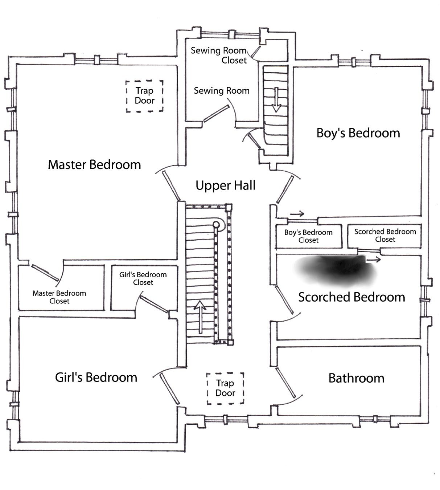

## План второго этажа

Подписи на плане:

| На плане | Перевод |
|---|---|
| Sewing Room Closet | Чулан швейной комнаты |
| Sewing Room | Швейная комната |
| Trap Door | Люк |
| Boy's Bedroom | Спальня мальчика |
| Master Bedroom | Хозяйская спальня |
| Upper Hall | Верхний коридор |
| Boy's Bedroom Closet | Чулан спальни мальчика |
| Scorched Bedroom Closet | Чулан обожжённой спальни |
| Scorched Bedroom | Обожжённая спальня |
| Girl's Bedroom Closet | Чулан спальни девочки |
| Master Bedroom Closet | Чулан хозяйской спальни |
| Girl's Bedroom | Спальня девочки |
| Bathroom | Ванная |

**Чулан спальни девочки** выходит в **спальню девочки**; здесь сильно пахнет помётом летучих мышей. Одна панель потолка снята, и через проём можно попасть в очень тесное **малое чердачное помещение**; чтобы забраться туда, нужна проверка **Физкультура**, и поместятся там не больше двух юных сыщиков. Всё, что там хранилось, грубо разбросано: набор детских деревянных стульчиков, коробки с детской одеждой, игрушками, детскими книжками и прочим — всё свалено в беспорядочную кучу. Многие поверхности усеяны мерзкими пятнами помёта. На потолке над ними висят, пожалуй, два-три десятка (обычных) летучих мышей, которые как раз просыпаются. Каждый, кто забирается сюда, сначала проходит проверку **Красться**; при крахе он тревожит летучих мышей, и они срываются стаей (см. ниже). При любом провале просыпаются одна-две летучие мыши и начинают порхать вокруг; каждый, кто находится в помещении, проходит проверку Удачи, чтобы летучая мышь не пролетела слишком близко, — иначе нужна проверка Рассудка (потеря 0/1), чтобы сохранить спокойствие и не шуметь. Если провалена и она, летучие мыши тоже срываются стаей. Падение из малого чердачного помещения наносит 1d6 урона.
