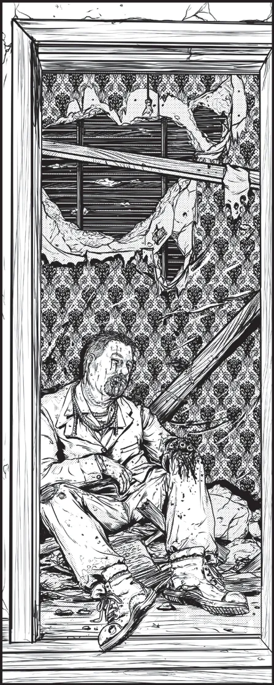

Кто преуспеет в проверке **Природа**, подтвердит, что крысы не нападают на здоровых взрослых, тем более со смертельным исходом. Эта догадка стоит ещё 1 Рассудка.

Проверка **Жуткие штуки** напомнит, что колдун может изготовить страшный магический талисман из руки повешенного, особенно преступника. Он называется «Рука славы», и с его помощью можно запереть или отпереть все двери в доме, погрузить его обитателей в сверхъестественный сон или как-то иначе дать своему создателю власть над домом, пока горит зажатая в нём свеча. Понимание этой связи стоит 1d2 Рассудка.

Из спальни дверь ведёт и в **большое чердачное помещение**. Там коробки со старыми документами, одеяла, чемоданы, книги, журналы, газеты и прочее — всё двадцатилетней, а то и большей давности. Если кто-нибудь переворошит весь этот хлам и преуспеет в проверке **Замечать всякое** (с бонусной костью, если ищут именно книги или бумаги), то найдёт потрёпанный альбом со множеством газетных вырезок, начиная с 1860-х годов. Проверка **Чтение, письмо и счёт** позволит понять, что большинство вырезок — о пропавших детях в этом городке. Альбом собрал мистер Бриггс ещё до исчезновения Донны Бриггс. Среди прочих примечательных статей:

- Статья 1885 года об исчезновении Эвелин Барнакер, первой хозяйки дома. Богатая вдова Барнакер переехала в городок в 1866 году из Массачусетса. По-видимому, она благотворительствовала местному сиротскому приюту и школе для «слабоумных» детей. Старуха, которая «в последнее время была не в себе», исчезла за одну ночь 2 февраля. Одну из её служанок, мисс Элайзу Фаулер, допросили и отпустили: она в то время гостила у родни. Другого слугу, мистера Эрастуса Бишопа, найти не удалось. Подозревали преступление, но так ничего и не доказали. Проверка **Жуткие штуки** позволит вспомнить, что 2 февраля — это (помимо Дня сурка) Сретение, или Праздник свечей, как его ещё называют; некоторые считают его оккультным праздником, связанным с рождением (или перерождением).
- Несколько заметок о странных явлениях, которые видели в доме Барнакеров, — когда в нём жили или когда он временно пустовал. В основном это огни в пустом доме. Их источник так и не нашли.
- Ещё одна заметка рассказывает о жильце, который сбежал из дома и был — по крайней мере на время — помещён в лечебницу для душевнобольных. Он жаловался, что в пустых комнатах слышны голоса, ночами раздаётся странный плач, похожий на младенческий, и кажется, будто за тобой следят.
- На последних страницах приклеены скотчем записки карандашом. В нескольких упоминаются некий Джон Роуз с женой из Аркхема в колонии Массачусетского залива, обвинённые в колдовстве и посаженные в тюрьму, но в 1693 году отпущенные без суда, когда губернатор Фипс прекратил салемские процессы. В одном источнике — к сожалению, без указания, в каком, — миссис Роуз названа Эллен (Линн) Роуз.
- Последний — вложенный — лист, вырванный из другой книги. Судя по всему, это страница из книги преподобного Монтегю Саммерса «Колдовство и чёрная магия» (*Witchcraft and Black Magic*), где обсуждаются разные способы распознать ведьму и навредить ей. Карандашом подчёркнут раздел о том, что ведьмы не выносят железа и серебра, а также раздел о действенности огня.

