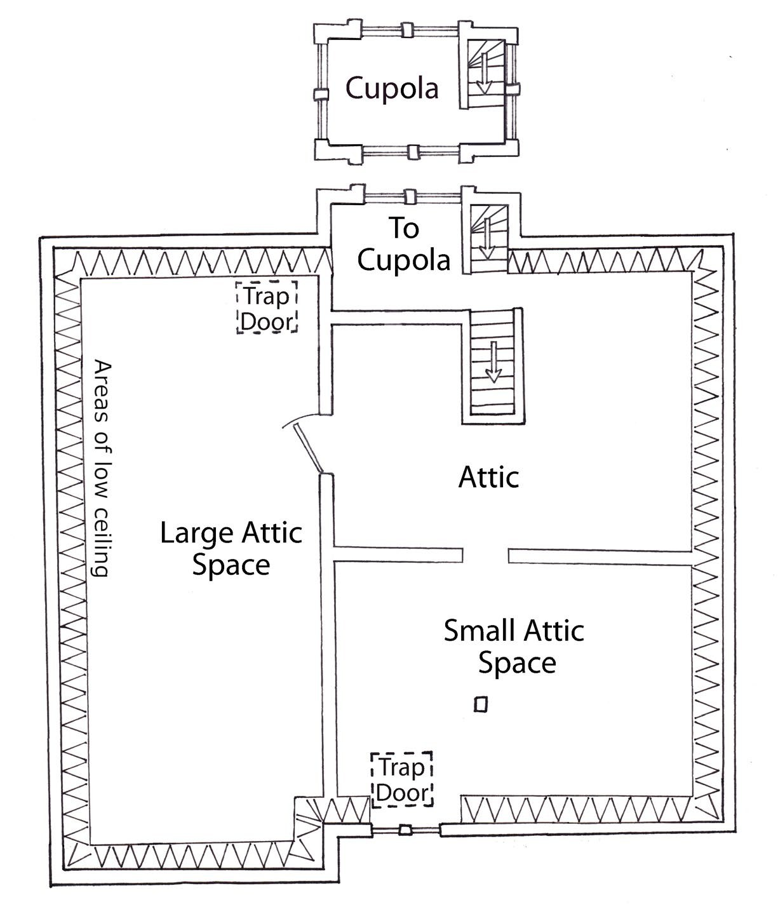

При провале повторной проверки куча угля может осыпаться, и карабкающийся скатится прямо в гнездо крысят, которые кусают его за лицо: 1d2 урона и потеря **Рассудка** 0/1d3. Здесь лежит лопата, а при групповой проверке **Удачи** — может, найдётся и крыса-другая.

**Кладовая** примыкает к **угольной**. В ней полки с лопнувшими банками, где когда-то хранились варенья, желе, соки, соусы и прочее. Полки либо липкие, либо мохнатые — смотря на что наткнётся юный сыщик: на пятно засохшей жижи или на плесень. Здесь отвратительно пахнет гнилью, полки, стены и пол покрыты пятнами всех сортов. Кто войдёт и осмотрится, при успешной проверке **Замечать всякое** найдёт целую банку — одну из немногих, — спрятанную в глубине полки. Внутри в прозрачной розоватой жидкости плавают несколько человеческих глаз. Это, без сомнения, человеческие глаза; такая находка стоит 1/1d3 **Рассудка**. Эвелин, которой вечно нужны свежие глаза, давным-давно забыла об этой банке.

**«Кабинет»** находится напротив **мастерской**, за хорошо скрытой дверью: чтобы её заметить, нужна проверка **Замечать всякое**. Из обстановки — только заплесневелый, сгнивший диван, два таких же истлевших мягких кресла и несколько книжных шкафов от пола до потолка. Все книги на нижних полках съедены крысами или погибли от сырости. Несколько томов на верхних полках тоже изгрызены или попорчены сыростью. Ту часть библиотеки и оккультных вещей, что хранилась здесь и была ещё нужна Эвелин, унесли в туннели под домом, когда началось её превращение.

Всякий, кто осмотрит книжные шкафы, заметит, что на одной большой чёрной книге высоко на верхней полке сидит крупная крысиная тварь, которая, когда её замечают, наполовину шипит, наполовину хрюкает. Она не убежит и нападёт, если кто-нибудь полезет за книгой. Она не покинет полку, разве что её атакуют метательным оружием, и будет защищать книгу, пока её не убьют. Чтобы добраться до книги, нужна успешная проверка **Физкультуры**. Чтобы драться с крысиной тварью, держась за полки, нужна успешная проверка **Физкультуры** каждый раунд, иначе юный сыщик срывается: провал — падение и 1d3 урона, а крах — обрушение всей секции шкафа, 1d6+1 урона всем, кто рядом, и книга погублена.

*План чердака. Подписи: Cupola — купол; To Cupola — лестница в купол; Trap Door — люк (два); Attic — чердак; Large Attic Space — большое чердачное помещение; Small Attic Space — малое чердачное помещение; Areas of low ceiling — места с низким потолком.*
