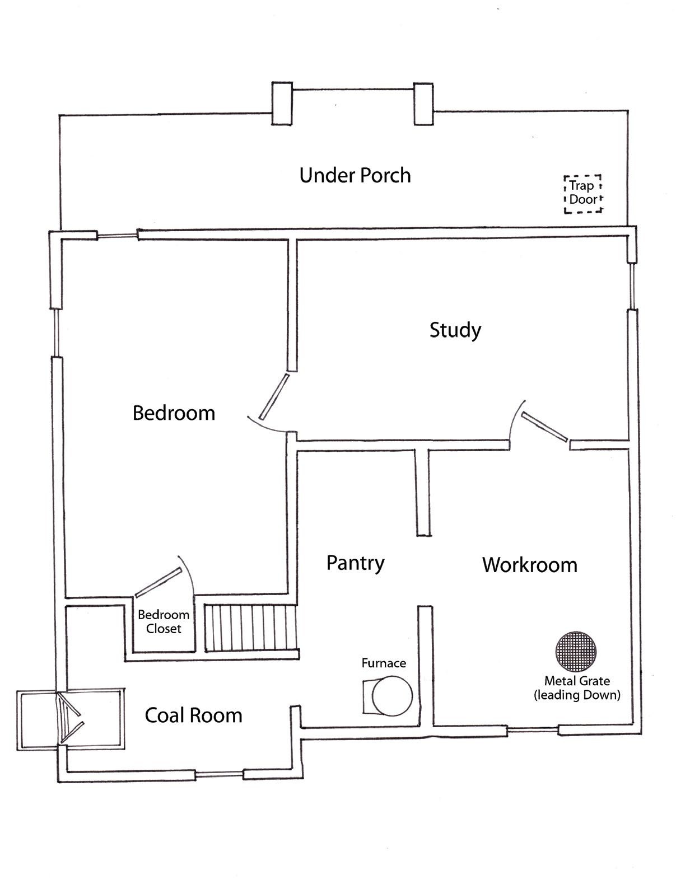

*План подвала. Подписи: Under Porch — подполье под крыльцом; Trap Door — люк; Study — кабинет; Bedroom — спальня; Bedroom Closet — чулан спальни; Pantry — кладовая; Workroom — мастерская; Furnace — печь; Metal Grate (leading Down) — металлическая решётка (ведёт вниз); Coal Room — угольная.*

Книга очень старая — рукопись на неровно обрезанной бумаге в переплёте из плесневеющей чёрной кожи. Кто пройдёт проверку **ОБР**, поймёт, что ей не меньше 200 лет. Большинство страниц слиплись, многие отваливаются от переплёта большими хрупкими кусками. Успешная проверка **Чтение, письмо и счёт** позволит извлечь сведения из *раздатки 1* — с одной из очень немногих читаемых страниц рукописного текста. Юные сыщики могут повторить проверку, если будут особенно бережны, возьмут увеличительное стекло или вынут страницы из книги и разложат их на полу. При провале повторной проверки страницы могут рассыпаться в прах, старый книжный шкаф — внезапно рухнуть на читающего (1d4 урона), а побеждённая крысиная тварь — вдруг ожить ради последней внезапной атаки. Чтение этого фрагмента стоит 1/1d3 **Рассудка**.
