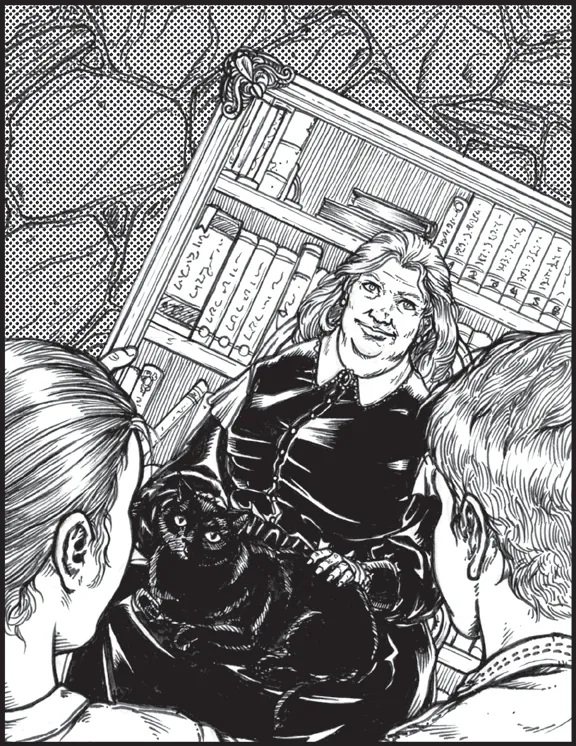

## Под подвалом

Пространство под подвалом дома Барнакеров вырыли Эвелин и её нечеловеческие слуги за те годы, что прошли с тех пор, как она оставила жизнь человека. Ходы рассчитаны на человека, хотя большинство туннелей высотой около 1,5 м, так что взрослым приходится пригибаться. В большей камере потолок заметно выше. Человек может попасть сюда двумя путями — через закрытую решётку в **мастерской** и через туннель, соединённый с люком, спрятанным под крыльцом. Другие, куда более узкие ходы позволяют крысиным и нетопыриным тварям свободно сновать туда-сюда. Растис легко протискивается сквозь просветы решётки.

Вход из **мастерской** начинается с отвесного спуска примерно на 3 м до грязного пола внизу. В стенах вырублены небольшие уступы, так что сыщики довольно легко могут спуститься или подняться. Из угла этой маленькой камеры узкий туннель уходит глубже в землю.

Давно заброшенный вход через люк под крыльцом — это узкий лаз с ветхой, но целой деревянной лестницей, ведущей вниз, в узкий наклонный туннель, уходящий в землю: стены сочатся влагой, вдоль одной стороны бежит тонкая струйка воды, тут и там стоят лужицы мерзкой воды.

Успешная проверка **Красться** позволит юным сыщикам подобраться незамеченными — по крайней мере, снующими паразитами.

Оба туннеля ведут в большую неправильной формы комнату примерно 10 м в поперечнике и 15 м в длину. Стены из утрамбованной земли, высотой около 3 м; свод неровный, высотой от 3 до 5 м. Посреди комнаты — груда костей высотой метр-полтора и почти 3 м в поперечнике. Кости звериные и человеческие — почти сплошь детские. Вдоль восточной стороны комнаты стоит небольшая лужа стоячей воды. Видно, как снуют крысы и крысиные твари, а в углублениях свода гнездятся летучие мыши и нетопыриные твари. На западной стороне комнаты, которую не видно сразу ни от одного из входов, есть ниша, где обитает Эвелин.

Каждый юный сыщик, увидевший ведьму, проходит проверку **МОЩ** против **МОЩ** ведьмы, равной 120. Если ребёнок побеждает, он видит мерзкую каргу в её собственном облике — раздутое искажение женщины с портрета под лестницей в подвале: глаза давно сгнили, сама она раздутая и лоснящаяся, как адская личинка. Юные сыщики, не сумевшие противостоять влиянию ведьмы, видят свою бабушку, сидящую на полу этой ниши, скрестив ноги. Кто провалил проверку **МОЩ**, не может атаковать Эвелин и будет атаковать её прислужников, только если нападут на него, — пока чары не спадут или он не пройдёт следующую проверку **МОЩ**.

Видят ли дети Эвелин Барнакер или свою бабушку, женщина перед ними грязная, бледная, раздутая, и по её телу и вокруг него снуют, извиваются, ползают и копошатся всевозможные мерзкие паразиты — крысы, пауки, черви, змеи и насекомые всех видов. Потеря **Рассудка** — 1d3/1d10 для тех, кто видит ведьму, и 1d2/1d6+1 для тех, кто видит свою бабушку в столь отвратительном положении.

*Прим. перев.: так в оригинале — в статблоке Эвелин (с. 35) потеря Рассудка другая: 1d3/2d4+1 в облике «бабушки» и 1d4/2d6 в её собственном облике.*

Те, кто видит Эвелин, видят, как она на миг напрягается, а затем с хлопком и лёгким всплеском ведьма рожает на грязный пол ещё одну крысиную или нетопыриную тварь. На новорождённое чудовище тут же налетают крысы и крысиные твари и уносят его в один из множества крысиных лазов, которыми изрыты стены комнаты. Свидетель этого противоестественного рождения теряет 1d2/1d6 **Рассудка**. Потянувшись к одной из грубых ниш за спиной, Эвелин берёт с блюда свежий глаз и вставляет его в одну из своих сгнивших глазниц. «Дай-ка посмотреть на тебя, сла-а-адкие мои детки…» — рокочет она голосом на несколько октав ниже, чем можно ждать от вашей бабушки.

