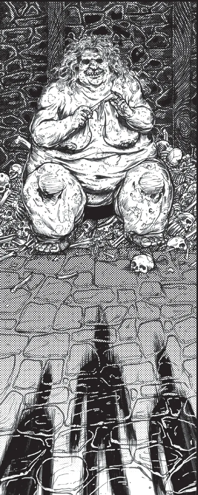

А потом, на глазах у перепуганных детей, женщина — в каком бы облике она ни была — вдруг срывается со своего грязного места и, переваливаясь, ковыляет к ним. Хохоча, голосом, сочащимся злобой, она рычит: «Иди к бабуле, деточка! Дай-ка я тебя крепко обниму!» Эвелин попытается сгрести одного из юных сыщиков — скорее всего, ближайшего из тех, кто под её чарами, — и начнёт его пожирать. Видеть, как пожирают другого ребёнка, — потеря **Рассудка** 1d4/2d6. Когда Эвелин нападает, сыщики, которые всё ещё под действием её «Бабушкиного морока», могут снова пройти проверку против её **МОЩ** 120, но на этот раз с бонусной костью, чтобы увидеть её такой, какая она есть. Обманутые сыщики могут и дальше проходить проверки с бонусной костью против **МОЩ** Эвелин, пока нападают на них или на их друзей. Разрушенный морок нельзя восстановить.

Эвелин привыкла охотиться на детей по одному и удивится, когда сыщики дадут отпор, особенно если они подготовились к бою. Раненая, она отступит в свою нишу и начнёт творить заклинания, пока её прислужники вступают с детьми в бой. Подробнее о тактике Эвелин в бою — в разделе «Битва с Эвелин» на с. 28.

В нише Эвелин видны вырубленные в стене углубления, где лежат разные оккультные принадлежности, истлевающие бумаги, книга, человеческие черепа и т. п. Среди прочих оккультных вещей выделяется Рука славы — в данном случае сделанная из кисти Старого Дэнни, убитого бродяги, чьи останки лежат в чулане **хозяйской спальни**. Из ладони торчит толстая чёрная свеча, её пламя потрескивает противоестественным фиолетовым светом. Если пламя погасить, заклинание Эвелин «Запечатать дом» разрушено. Свечу можно задуть обычным образом; чтобы попасть в неё чем-нибудь брошенным — камнем, комом земли, оглушённой крысой и тому подобным, — нужна трудная проверка **Физкультуры**. Можно также целиться в Руку славы из дальнобойного оружия.

В одном углу логова ведьмы (отмеченном на плане буквой X) юные сыщики замечают, что из участка открытой кирпичной кладки постоянно сочится вода, питающая лужу. Кто видел цистерну снаружи и пройдёт проверку **ИНТ**, верно догадается, что вода идёт из цистерны. Если юным сыщикам удастся выбить часть кирпичей, цистерна сольётся в эту комнату — и хлынувшая волна смоет всех крыс и крысиных тварей в комнате. Каждое очко урона, нанесённого кладке (проверки атаки по-прежнему нужны, чтобы удар был действенным), даёт накопительный шанс 5%, что кирпичи поддадутся. Хранитель суммирует урон за каждый раунд и бросает раз в раунд. **Версия «PG»:** добрый Хранитель может бросать каждый раунд после первого удара — давление воды в цистерне выталкивает повреждённые кирпичи, — но это крайнее средство.

