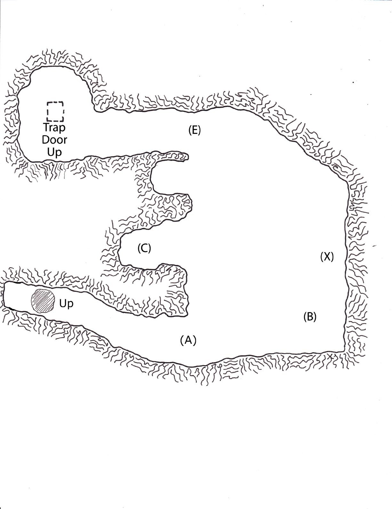

Растис слишком ловок: он вскарабкается на груду костей (или в другое удобное сухое место), а летучих мышей и нетопыриных тварей вода не задевает. Все остальные в комнате до конца боя замедлены на X, потому что пол теперь залит водой на 30–60 см. Туннели наверх и задняя часть ниши Эвелин остаются сухими, как и верх груды костей. (Через пролом из дома не выбраться: цистерна глубже 6 м, и без верёвки до люка не добраться — склизкие стены слишком круты, чтобы по ним влезть.)

*Прим. перев.: так в оригинале — «замедлены на X»: насколько вода снижает Скорость, книга не говорит.*

> **Ключ к плану туннелей**
>
> **TD:** люк наверх.
>
> **(A):** малая комната с земляными стенами и полом. Из одного угла уходит земляной ход, оттуда слышны журчание и слабое шуршание.
>
> **(B):** люк из пространства под лестницей в подвал.
>
> **(C):** здесь повсюду кости (людей и животных), множество крыс и изредка летучая мышь.
>
> **(D):** Эвелин. «Здравствуйте, мои сладкие!»
>
> **(E):** в одном углу логова ведьмы дети могут заметить, как постоянно капает вода (из цистерны; если пробить — комнату затопит).
>
> **(F):** узкий туннель, идущий вверх. Проползя по нему, ребёнок выберется через люк под парадным крыльцом.

## План туннелей

*План туннелей. Подписи: Trap Door Up — люк наверх; Up — подъём (к решётке в мастерской); (A), (B), (C), (E) — места по ключу; (X) — угол с открытой кирпичной кладкой (см. с. 26).*

*Прим. перев.: так в оригинале — ключ и план не совпадают: на плане нет меток (D) и (F), зато есть (X), которой нет в ключе; угол с водой из цистерны в тексте отмечен X, а в ключе — (E), и на плане это разные места.*
