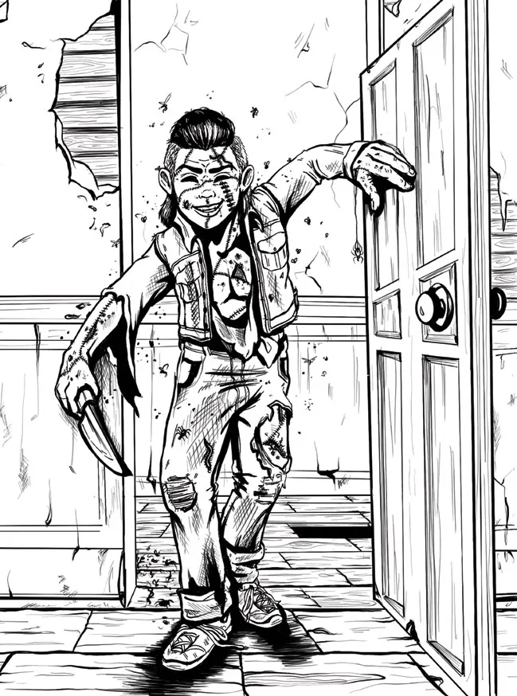

# Характеристики существ и персонажей

## Роджер Симмонс

Когда-то Роджер был человеком, но теперь он лишь оболочка себя прежнего — в буквальном смысле. Убитый ведьмой Эвелин Барнакер и её прислужниками, Роджер поднят кожаным слугой: его пустая кожа набита ползающими и копошащимися паразитами, которые каким-то образом выдают себя за человека.

Для всех Роджер выглядит обычным ребёнком. Попав в дом со своими будущими жертвами, он может невольно немного утратить бдительность: кожа подёргивается и обвисает или неестественно вздувается. Вскоре после того, как дети войдут в дом, Роджер ускользнёт и попытается переловить их по одному, чтобы скормить ведьме. Он постарается разделить детей, предпочитая нападать на одиночку или подкрадываться к кому-нибудь из компании сзади. Его оружие (нож и дубинка) спрятано в доме там, где он может незаметно его забрать.

Роджер будет для детей мелькающей тенью. Раненный, но не убитый, он может пробраться в пещеру под подвалом и ждать их там. Если Роджера убить, его кожа опадает, и из ставшей бесполезной кожи выползают жуки, змеи, черви и прочая мерзость. Потеря **Рассудка** при таком зрелище — 1d4/1d8.

```stat
РОДЖЕР СИММОНС, мстительный задира и нежить

СИЛ 50    ВЫН 75    ТЕЛ 45
ИНТ 50    МОЩ 25    ЛВК 45
НАР 40    ОБР 30    Рассудок 0
ПЗ 12     БкУ: нет
ПМ: 5     Комплекция: 0     СКО: 8

АТАКИ
Атак за раунд: 1
Драка                 55% (27/11), урон 1d3
Небольшая дубинка     45% (22/9), урон 1d6
Большой нож           35% (17/7), урон 1d6+1
Уклонение             50% (25/10)

Навыки: Красться 65%, Мифы Ктулху 10%, Физкультура 55%, Замечать всякое 35%, Дразнить 20%.

Защита: нет; кожаные слуги вроде Роджера (который немногим больше, чем кожаный мешок, набитый паразитами) получают ½ урона от дробящего оружия и полный урон — только при проникающей ране.

Потеря Рассудка: 1d3/1d6, когда юные сыщики узнают, что такое Роджер на самом деле. Ещё 1d4/1d8 можно потерять, если Роджера убить так, что его пункты здоровья падают ниже нуля: из пустой оболочки, бывшей его кожей, вырываются сотни пауков, червей и прочей мерзости.
```

*Прим. перев.: так в оригинале — здесь у большого ножа урон 1d6+1, а в разделе «Битва с Эвелин» (с. 28) — 1d4.*


