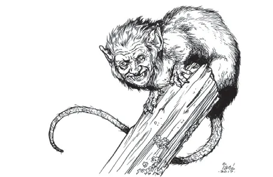
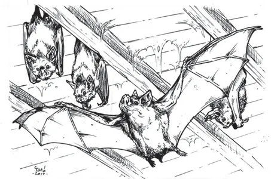
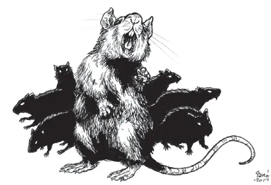

## Стаи крыс, *rattus rattus*



У этих существ средние характеристики (см. с. 338 «Книги хранителя» «Зова Ктулху»; номер страницы — по английскому изданию). Если не сказано иное, есть ли в комнате крысы, решает Хранитель; в каждой встреченной стае — 3d6 крыс. Эти существа нужны в основном для атмосферы; не перестарайтесь — это не Экзем-Прайори! Описывая стаи крыс, избегайте точных чисел. Детское воображение может превратить стаю из 6 крыс в голодную орду — опишите её как волну чёрных бусинок-глаз, усов, шерсти и зубов.

Громкий шум, резкие движения и открытый огонь крупнее свечи каждый раз отгоняют около 20% стаи крыс (если только крысами прямо не командует Эвелин); иначе каждая успешная атака убивает одну крысу на каждые три очка нанесённого урона. Стая крыс, потерявшая ½ изначальной численности или больше, бежит.

Потеря **Рассудка** от стаи крыс — 1/1d3, но только за первую встреченную стаю. За следующие встречи потерь нет, если только у юного сыщика нет какой-нибудь фобии, но это выходит за рамки сценария.

*Прим. перев.: так в оригинале — «average slats» вместо «average stats» (здесь и у летучих мышей).*

## Стаи летучих мышей, *myotis lucifugus*

Как и у их грызущих собратьев, у этих существ средние характеристики (см. с. 336 «Книги хранителя» «Зова Ктулху»; номер страницы — по английскому изданию), и если не сказано иное, их присутствие решает Хранитель. Летучие мыши встретятся, скорее всего, только на втором этаже, на чердаке и в логове Эвелин. Стая летучих мышей — это 2d6+6 зверьков; как и с крысами, описывая их, говорите о хлопанье крыльев, пронзительном писке и внезапных, неожиданных движениях. Громкий шум, резкие движения и открытый огонь крупнее свечи каждый раз отгоняют около 20% стаи (если только мышами прямо не командует Эвелин); иначе каждая успешная атака убивает одну летучую мышь на каждые два очка нанесённого урона. Стая летучих мышей, потерявшая ½ изначальной численности или больше, бежит.

Потеря **Рассудка** от стаи летучих мышей — 1/1d3, но только за первую встреченную стаю. За следующие встречи потерь нет, если только у юного сыщика нет какой-нибудь фобии, но это выходит за рамки сценария.



## Крысиные твари, противоестественные злобные шныри

| | #1 | #2 | #3 | #4 | #5 | #6 | #7 | #8 | #9 | #10 | #11 | #12 |
|---|---|---|---|---|---|---|---|---|---|---|---|---|
| **СИЛ** | 10 | 10 | 15 | 10 | 5 | 10 | 15 | 10 | 10 | 5 | 15 | 10 |
| **ВЫН** | 35 | 30 | 35 | 20 | 40 | 35 | 45 | 30 | 55 | 30 | 45 | 35 |
| **ТЕЛ** | 5 | 5 | 5 | 5 | 5 | 5 | 5 | 5 | 5 | 5 | 5 | 5 |
| **ИНТ** | 35 | 40 | 50 | 25 | 35 | 15 | 20 | 30 | 25 | 25 | 35 | 39 |
| **МОЩ** | 40 | 25 | 15 | 45 | 35 | 30 | 25 | 45 | 35 | 15 | 20 | 40 |
| **ЛВК** | 90 | 100 | 95 | 55 | 70 | 95 | 110 | 100 | 85 | 115 | 65 | 90 |
| **ПЗ** | 4 | 3 | 4 | 2 | 4 | 4 | 5 | 3 | 6 | 3 | 5 | 4 |

```stat
Средний БкУ: −2
Средняя Комплекция: −2
Средняя СКО: 9

АТАКИ
Атак за раунд: 1
Ближний бой       35% (17/7), 1d4 + БкУ
Уклонение         45% (22/9)

Броня: нет, но атаки по движущейся крысиной твари совершаются со штрафной костью.
Навыки: Красться 80%.
Потеря Рассудка: 0/1d6 за то, чтобы увидеть крысиную тварь.
```


