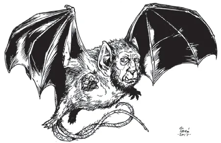
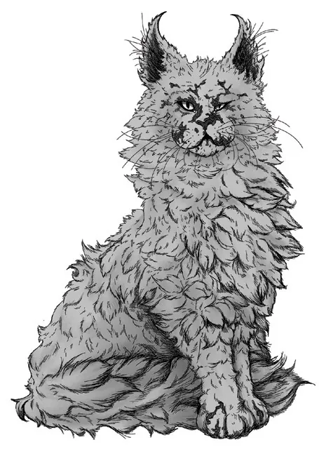

## Нетопыриные твари, порхающие кощунства

Магическое порождение Эвелин Барнакер, это существо — жуткая смесь человека и летучей мыши. Ещё сильнее, чем обычные крысиные твари, рождённые Эвелин склонны к телесным уродствам: лишние конечности, преувеличенные части тела, асимметрия, опухоли и т. п. Поодиночке они не слишком храбры, но смелее обычных крыс. В стае они гораздо наглее и гораздо агрессивнее.

*Прим. перев.: в оригинале — «смесь человека и крысы»; по смыслу и по рисунку — летучей мыши.*

Некоторые из этих существ могут сохранять обрывки памяти о себе прежних и потому смотреть на новых жертв Эвелин с жалостью. Терпеливые и добрые юные сыщики, возможно, сумеют заручиться помощью сочувствующей крысиной твари; подробнее — на с. 20.

Эвелин не научила своих рабов — нетопыриных и крысиных тварей — никаким заклинаниям.



### Дюжина нетопыриных тварей, использовать повторно по необходимости

| | #1 | #2 | #3 | #4 | #5 | #6 | #7 | #8 | #9 | #10 | #11 | #12 |
|---|---|---|---|---|---|---|---|---|---|---|---|---|
| **СИЛ** | 10 | 10 | 5 | 15 | 10 | 15 | 5 | 10 | 15 | 10 | 5 | 10 |
| **ВЫН** | 30 | 15 | 35 | 35 | 45 | 25 | 50 | 30 | 55 | 45 | 45 | 55 |
| **ТЕЛ** | 5 | 5 | 5 | 5 | 5 | 5 | 5 | 5 | 5 | 5 | 5 | 5 |
| **ИНТ** | 30 | 15 | 35 | 35 | 45 | 50 | 45 | 40 | 50 | 40 | 45 | 35 |
| **МОЩ** | 30 | 45 | 25 | 25 | 60 | 30 | 45 | 35 | 35 | 45 | 50 | 30 |
| **ЛВК** | 85 | 130 | 105 | 80 | 85 | 135 | 125 | 120 | 65 | 480 | 110 | 95 |
| **ПЗ** | 4 | 2 | 3 | 4 | 5 | 3 | 5 | 3 | 6 | 5 | 5 | 6 |

*Прим. перев.: так в оригинале — ЛВК 480 у особи #10 (явная опечатка, верное значение не восстановить) и ПЗ 3 у особи #3 (по ВЫН и ТЕЛ выходит 4).*

```stat
Средний БкУ: −2
Средняя Комплекция: −2
Средняя СКО: 10

АТАКИ
Атак за раунд: 1
Укус          35% (17/7), 1d3 + БкУ
Уклонение     95% (47/19)

Броня: нет, но атаки по летящей нетопыриной твари совершаются со штрафной костью.
Навыки: Красться 40%, Замечать всякое 50%.
Потеря Рассудка: 1/1d6 за то, чтобы увидеть нетопыриную тварь.
```

## Растис

Растис — большой серый, зловещий на вид кот со злобным разумом. Шерсть у него свалялась, шкура исполосована шрамами; он упивается охотой и засадами на (в основном) зверьков у дома. Он фамильяр Эвелин Барнакер: что видит он, видит и она. Он знает немного магии и предпочитает пользоваться заклинаниями, а не нападать физически; к последнему он прибегнет, только если его загнать в угол.



```stat
РАСТИС, кошачий фамильяр Эвелин

СИЛ 10    ВЫН 50    ТЕЛ 5    ИНТ 75    МОЩ 90
ЛВК 145                                ПЗ 5
БкУ: −2                                ПМ: 18
Комплекция: −2
СКО: 10

АТАКИ
Атак за раунд: 2
Когти           50% (25/10), урон 1d3
Укус            35% (17/6), урон 1d4
Задние когти    40% (20/8) (если укус удался), урон 2d3
Уклонение       90% (45/18)

Броня: нет; полагается на скрытность и увёртливость.
Навыки: Красться 90%, Физкультура 75%, Замечать всякое 80%.
Потеря Рассудка: 0/1d3 за то, чтобы увидеть Растиса, если понимаешь, что он фамильяр ведьмы или вообще сверхъестественное существо.
Заклинания: Утопить разум, Сглаз, Зародить страх, Заворожить; советы, как их применять, — на с. 28.
```

*Прим. перев.: так в оригинале — у укуса «(17/6)»; пятая часть от 35% — 7, то есть (17/7).*
