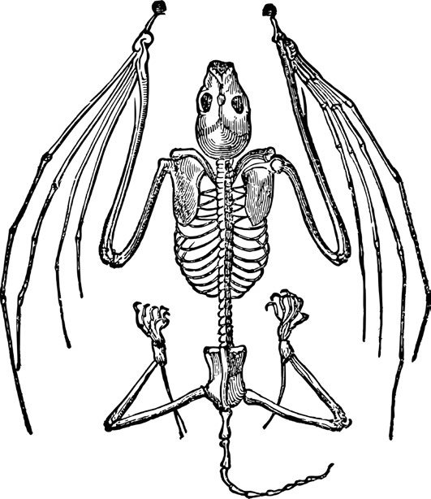

```stat
ЭВЕЛИН БАРНАКЕР, бессмертная ведьма-людоедка и оживший кошмар

СИЛ 45    ВЫН 75    ТЕЛ 90    ИНТ 85    МОЩ 120
ЛВК 45    НАР 10    ОБР —     Рассудок 90    ПЗ 16
БкУ: +1d4                     ПМ: 24
Комплекция: 1
СКО: 6

АТАКИ
Атак за раунд: 1*
Пожирание, 100%, но только против неподвижного противника. 2d6 урона, пока жертву не съедят или не вытащат.

Навыки: Мифы Ктулху 80%, Замечать всякое 30%, Порождать паразитов 99%, Жуткие штуки 99%.
Защита: 1 пункт иссохшей, твёрдой как железо плоти.
Заклинания: Стать призраком, Укрощение животного (летучая мышь), Укрощение животного (крыса), Вызов Чёрного человека (Ньярлатхотепа), Свечная связь, Затуманить память, Вызвать бурю, Создание кожаного слуги, Притушить пламя, Сглаз, Заворожить, Истощение сил, Взгляд сквозь зеркала, Запечатать дом, Разрушение.

Потеря Рассудка: 1d3/2d4+1, если она является в облике «бабушки»; 1d4/2d6, если в своём собственном бледном, раздутом, грязном облике.

Особые способности:
Бабушкин морок. Эта сила стоит всего 1 пункт магии и требует проверки МОЩ против МОЩ Эвелин, равной 120. Если побеждает ведьма, зритель видит свою бабушку в тех ужасных условиях, в которых на самом деле живёт Эвелин. Если зритель устоял, он не видит никакого морока — только ведьму такой, какая она есть. Атаковать её могут только те, кто видит Эвелин такой, какая она есть.
Пожирание (манёвр). Обездвиженную жертву — под «Бабушкиным мороком» или под одним из заклинаний Эвелин — можно проглотить целиком. Эвелин поднимает жертву и затягивает её в рот, а её челюсть по-змеиному раскрывается, чтобы поглотить жертву; из всё удлиняющейся глотки разворачиваются ряды бритвенно-острых зубов, а мышцы шеи сжимаются и разжимаются, затягивая жертву всё глубже в адскую пасть. Каждый раунд пожирания — 2d6 урона. Друзья могут попытаться вытащить юного сыщика из отвратительного рта Эвелин: сыщики (участвовать могут не больше 2) проходят проверку своей суммарной СИЛ против СИЛ Эвелин.
Заклинания. Эвелин — ведьма и знает много заклинаний; подробный список — во врезке рядом.
```

*Прим. перев.: так в оригинале — в разделе «Под подвалом» (с. 25) потеря Рассудка при виде Эвелин другая: 1d3/1d10 при виде ведьмы и 1d2/1d6+1 при виде «бабушки». Скорость 6 — как напечатано (по характеристикам вышло бы 7; видимо, задумано: Эвелин почти неподвижна).*


