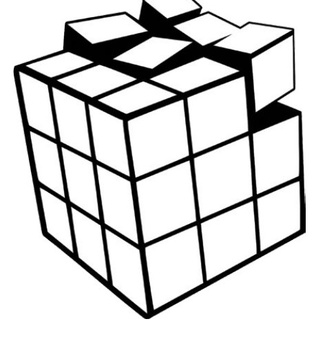

**Характеристики.** Чтобы определить характеристики, бросьте такие кости:

- (1d4−2)+6 × 5 — **ОБР**;
- 1d6+6 × 5 — **СИЛ** и **ТЕЛ**;
- 2d6+3 × 6 — **НАР** и **ВЫН**;
- 3d6 × 5 — **ИНТ**, **ЛВК**, **МОЩ** и **Удача**;
- пункты магии равны вашей **МОЩ**, делённой на 5;
- пункты здоровья равны вашим **ТЕЛ** + **ВЫН**, делённым на 10;
- **Рассудок** равен вашей **МОЩ**.

*Прим. перев.: так в оригинале — у НАР и ВЫН множитель ×6, у остальных характеристик ×5 (у готовых юных сыщиков НАР и ВЫН кратны 5; возможно, имелось в виду ×5).*

**Навыки.** Навыки юных сыщиков распределяются так: выберите 1 навык, к которому прибавляется 80 очков, 2 навыка — по 60, 3 навыка — по 40 и 4 — по 20 очков. Прибавьте эти очки к базе навыка; но максимум любого навыка — 99%, какой бы ни была база.

> **Создание навыков**
>
> На листе персонажа «На спор» мы оставили пустое место для навыка. Создавая юного сыщика, вы, возможно, захотите дать ему какие-то навыки, которых в сценарии нет (хотя честно предупреждаем: все юные сыщики сделаны для этого сценария, так что другие навыки, скорее всего, бесполезны). Если вы с Хранителем договорились о том, что навык даёт и где его пределы, смело добавляйте его своему персонажу. Если вы будете создавать свои сценарии по этим изменённым правилам, пустое место может пригодиться больше.

## Снаряжение

Какой на вас костюм? Что вы взяли из дома? Поможет ли это вам? Можете взять любую вещь, какую разрешит Хранитель, — всё равно она вам не поможет… бва-ха-ха-ха-ха-ха-а-а. Простите. Всё с вами будет хорошо. Веселитесь!

