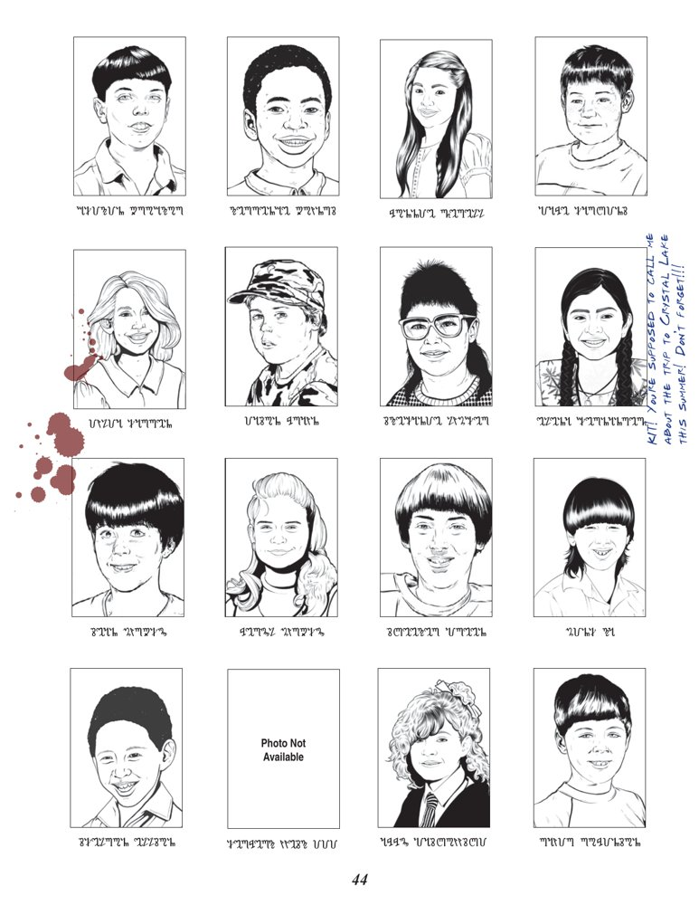

# Фото из школьного альбома

Подписи под портретами (по рядам, слева направо):

| | 1 | 2 | 3 | 4 |
|---|---|---|---|---|
| 1-й ряд | Читин Проктор (Chitin Proctor) | Терренс Паундс (Terrence Pounds) | Бонни Зеделл (Bonnie Zedell) | Гейб Харкинс (Gabe Harkins) |
| 2-й ряд | Джулия Харден (Julia Harden) | Джейсон Браун (Jason Braun) | Стефани Ламфер (Stefanie Lumfer) | Элена Фернандес (Elena Fernandez) |
| 3-й ряд | Шон Мёрфи (Sean Murphy) | Берил Мёрфи (Beryl Murphy) | Скитер Грин (Skeeter Green) | Минь Та (Minh Ta) |
| 4-й ряд | Шелдон Эллсон (Sheldon Ellson) | Герберт Уэст III (Herbert West III) — *«Фото нет»* | Эбби Гасковски (Abby Gaskowski) | Дэвид Робинсон (David Robinson) |

Надпись от руки сбоку от портрета Элены Фернандес:

> КИТ! С тебя звонок насчёт поездки на Хрустальное озеро этим летом! Не забудь!!!

*Прим. перев.: подписи под портретами в оригинале набраны нарочито «нечитаемым» шрифтом; имена даны по текстовому слою PDF. Это шуточные имена соавторов и спонсоров книги, а также отсылки к фильмам ужасов (Герберт Уэст — «Реаниматор», Хрустальное озеро — «Пятница, 13-е»). В текстовом слое страницы есть ещё невидимая надпись «O D B» рядом с кровавыми брызгами слева.*
