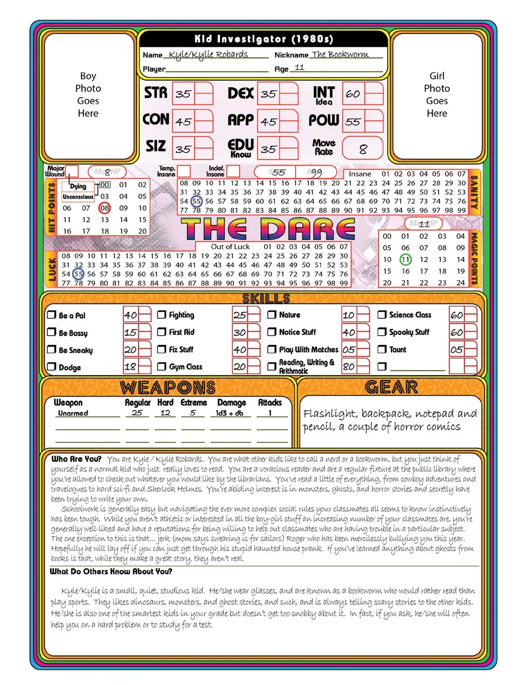

# Готовые юные сыщики

## Кайл/Кайли Робардс — «Книжный червь»

**Юный сыщик (1980-е)**

| Имя | Прозвище | Игрок | Возраст |
|---|---|---|---|
| Кайл/Кайли Робардс | Книжный червь | — | 11 |

| СИЛ | ВЫН | ТЕЛ | ЛВК | НАР | ОБР (Знание) | ИНТ (Идея) | МОЩ | Скорость |
|---|---|---|---|---|---|---|---|---|
| 35 | 45 | 35 | 35 | 45 | 35 | 60 | 55 | 8 |

**ПЗ** 8 · **ПМ** 11 · **Удача** 55 · **Рассудок** 55 (макс. 99)

*На листе — шкалы ПЗ, Рассудка, Удачи и ПМ с клетками для отметок «Серьёзная рана», «При смерти», «Без сознания», «Временное безумие», «Бессрочное безумие»; в углах — рамки «Фото мальчика» и «Фото девочки» для своего портрета.*

**Навыки**

| Навык | % | Навык | % | Навык | % | Навык | % |
|---|---|---|---|---|---|---|---|
| Быть другом | 40 | Драка | 25 | Природа | 10 | Школьные науки | 60 |
| Командовать | 15 | Первая помощь | 30 | Замечать всякое | 40 | Жуткие штуки | 60 |
| Красться | 20 | Чинить вещи | 40 | Играть со спичками | 05 | Дразнить | 05 |
| Уклонение | 18 | Физкультура | 20 | Чтение, письмо и счёт | 80 | — |  |

**Оружие**

| Оружие | Обычный | Трудный | Чрезвычайный | Урон | Атак |
|---|---|---|---|---|---|
| Без оружия | 25 | 12 | 5 | 1d3 + БкУ | 1 |

**Снаряжение:** Фонарик, рюкзак, блокнот и карандаш, пара комиксов ужасов.

### Кто ты?

Ты — Кайл / Кайли Робардс. Другие дети зовут тебя ботаником или книжным червём, но сам(а) ты считаешь себя обычным ребёнком, который просто очень любит читать. Ты читаешь запоем и постоянно торчишь в публичной библиотеке, где библиотекари разрешают тебе брать что угодно. Ты читал(а) понемногу всего — от ковбойских приключений и путевых заметок до научной фантастики и Шерлока Холмса. Но больше всего тебя занимают чудовища, привидения и страшные истории, и ты втайне пытаешься писать свои.

Учёба даётся легко, а вот разбираться во всё более запутанных правилах общения, которые одноклассники будто знают от рождения, трудно. Хотя ты не спортсмен(ка) и тебя не интересует вся эта возня «мальчики — девочки», которой увлекается всё больше одноклассников, тебя в целом любят, и ты славишься тем, что охотно помогаешь тем, у кого не ладится с каким-нибудь предметом. Единственное исключение — этот… придурок (мама говорит, ругаются только матросы) Роджер, который весь этот год безжалостно тебя травит. Может, он отстанет, если просто пережить его дурацкую шутку с домом с привидениями. Если книги чему-то и научили тебя насчёт привидений, так это тому, что истории о них отличные, но самих их не бывает.

### Что о тебе знают другие?

Кайл/Кайли — маленький тихий прилежный ребёнок в очках, книжный червь, который лучше почитает, чем погоняет мяч. Любит динозавров, чудовищ, истории о привидениях и всё такое и вечно рассказывает другим детям страшилки. Один(одна) из самых умных в вашем классе, но не задаётся: если попросить, часто поможет с трудной задачей или подготовиться к контрольной.
