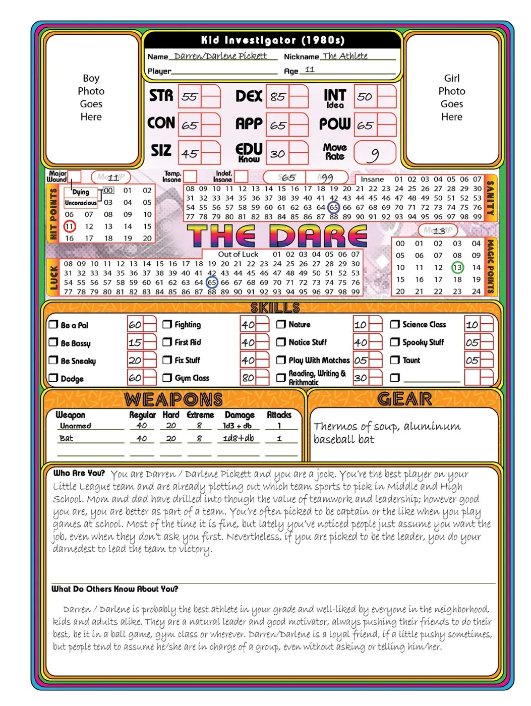

## Даррен/Дарлин Пикетт — «Спортсмен»

**Юный сыщик (1980-е)**

| Имя | Прозвище | Игрок | Возраст |
|---|---|---|---|
| Даррен/Дарлин Пикетт | Спортсмен | — | 11 |

| СИЛ | ВЫН | ТЕЛ | ЛВК | НАР | ОБР (Знание) | ИНТ (Идея) | МОЩ | Скорость |
|---|---|---|---|---|---|---|---|---|
| 55 | 65 | 45 | 85 | 65 | 30 | 50 | 65 | 9 |

**ПЗ** 11 · **ПМ** 13 · **Удача** 65 · **Рассудок** 65 (макс. 99)

*На листе — шкалы ПЗ, Рассудка, Удачи и ПМ с клетками для отметок «Серьёзная рана», «При смерти», «Без сознания», «Временное безумие», «Бессрочное безумие»; в углах — рамки «Фото мальчика» и «Фото девочки» для своего портрета.*

**Навыки**

| Навык | % | Навык | % | Навык | % | Навык | % |
|---|---|---|---|---|---|---|---|
| Быть другом | 60 | Драка | 40 | Природа | 10 | Школьные науки | 10 |
| Командовать | 15 | Первая помощь | 40 | Замечать всякое | 40 | Жуткие штуки | 05 |
| Красться | 20 | Чинить вещи | 40 | Играть со спичками | 05 | Дразнить | 05 |
| Уклонение | 60 | Физкультура | 80 | Чтение, письмо и счёт | 30 | — |  |

**Оружие**

| Оружие | Обычный | Трудный | Чрезвычайный | Урон | Атак |
|---|---|---|---|---|---|
| Без оружия | 40 | 20 | 8 | 1d3 + БкУ | 1 |
| Бита | 40 | 20 | 8 | 1d8 + БкУ | 1 |

**Снаряжение:** Термос с супом, алюминиевая бейсбольная бита.

### Кто ты?

Ты — Даррен / Дарлин Пикетт, спортсмен(ка). Лучший игрок своей команды Малой лиги, ты уже прикидываешь, в какие командные виды спорта пойти в средней и старшей школе. Мама и папа вбили тебе в голову ценность командной игры и лидерства: как бы хорош(а) ты ни был(а), в команде ты лучше. В школьных играх тебя часто выбирают капитаном, и обычно это нормально, но в последнее время ты замечаешь, что люди просто считают, будто ты этого хочешь, даже не спросив. И всё же, если тебя выбрали вожаком, ты из кожи вон лезешь, чтобы привести команду к победе.

### Что о тебе знают другие?

Даррен/Дарлин — пожалуй, лучший спортсмен в вашем классе, его(её) любят все в округе, и дети, и взрослые. Прирождённый вожак и мастер подбодрить: всегда подталкивает друзей выкладываться — в игре, на физкультуре и где угодно. Верный друг, хоть иногда и напористый; люди склонны считать, что он(а) главный(ая) в компании, даже никого не спросив.
