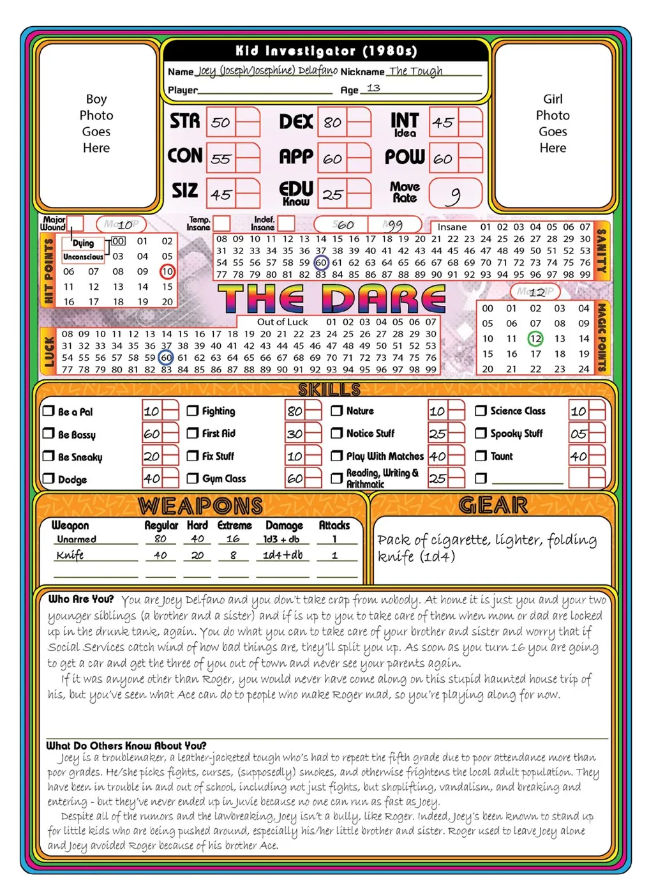

## Джоуи (Джозеф/Джозефина) Делафано — «Крутой»

**Юный сыщик (1980-е)**

| Имя | Прозвище | Игрок | Возраст |
|---|---|---|---|
| Джоуи (Джозеф/Джозефина) Делафано | Крутой | — | 13 |

| СИЛ | ВЫН | ТЕЛ | ЛВК | НАР | ОБР (Знание) | ИНТ (Идея) | МОЩ | Скорость |
|---|---|---|---|---|---|---|---|---|
| 50 | 55 | 45 | 80 | 60 | 25 | 45 | 60 | 9 |

**ПЗ** 10 · **ПМ** 12 · **Удача** 60 · **Рассудок** 60 (макс. 99)

*На листе — шкалы ПЗ, Рассудка, Удачи и ПМ с клетками для отметок «Серьёзная рана», «При смерти», «Без сознания», «Временное безумие», «Бессрочное безумие»; в углах — рамки «Фото мальчика» и «Фото девочки» для своего портрета.*

**Навыки**

| Навык | % | Навык | % | Навык | % | Навык | % |
|---|---|---|---|---|---|---|---|
| Быть другом | 10 | Драка | 80 | Природа | 10 | Школьные науки | 10 |
| Командовать | 60 | Первая помощь | 30 | Замечать всякое | 25 | Жуткие штуки | 05 |
| Красться | 20 | Чинить вещи | 10 | Играть со спичками | 40 | Дразнить | 40 |
| Уклонение | 40 | Физкультура | 60 | Чтение, письмо и счёт | 25 | — |  |

**Оружие**

| Оружие | Обычный | Трудный | Чрезвычайный | Урон | Атак |
|---|---|---|---|---|---|
| Без оружия | 80 | 40 | 16 | 1d3 + БкУ | 1 |
| Нож | 40 | 20 | 8 | 1d4 + БкУ | 1 |

**Снаряжение:** Пачка сигарет, зажигалка, складной нож (1d4).

### Кто ты?

Ты — Джоуи Делфано, и никому не даёшь спуску. Дома только ты и двое младших — брат и сестра, — и заботиться о них приходится тебе, когда маму или папу в очередной раз запирают в вытрезвителе. Ты делаешь для брата и сестры что можешь и боишься, что если соцслужба пронюхает, как всё плохо, вас разлучат. Как только тебе стукнет шестнадцать, ты купишь машину, увезёшь всех троих из города и больше никогда не увидишь родителей.

Будь это кто угодно, кроме Роджера, ты ни за что не пошёл(пошла) бы в этот дурацкий поход в дом с привидениями. Но ты видел(а), что Эйс делает с теми, кто злит Роджера, так что пока подыгрываешь.

### Что о тебе знают другие?

Джоуи — хулиган в кожаной куртке, оставленный на второй год в пятом классе скорее из-за прогулов, чем из-за оценок. Лезет в драки, ругается, (говорят) курит и вообще пугает местных взрослых. Неприятности в школе и вне её: не только драки, но и кражи в магазинах, вандализм, взломы — но в колонию так и не попал(а), потому что никто не бегает так быстро, как Джоуи.

Несмотря на все слухи и нарушения закона, Джоуи не задира, как Роджер. Наоборот, он(а) не раз заступался(лась) за малышей, которых обижают, особенно за своих младших брата и сестру. Роджер раньше не трогал Джоуи, а Джоуи обходил(а) Роджера стороной из-за его брата Эйса.

*Прим. перев.: в строке «Имя» фамилия написана «Delafano» (Делафано), а в тексте «Кто ты?» — «Delfano» (Делфано); оставлено как в оригинале.*
