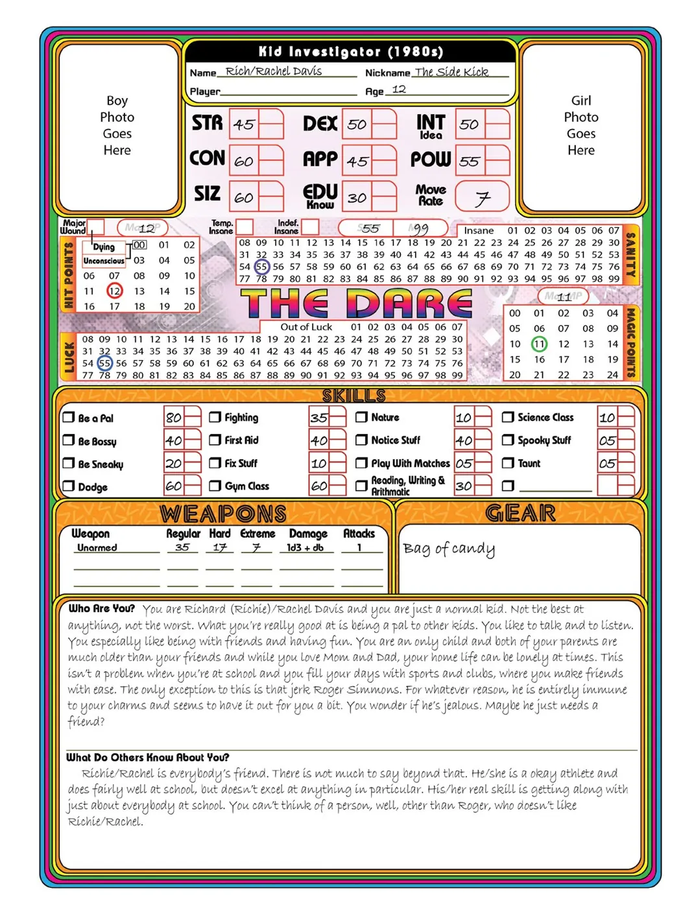

## Рич/Рейчел Дэвис — «Напарник»

**Юный сыщик (1980-е)**

| Имя | Прозвище | Игрок | Возраст |
|---|---|---|---|
| Рич/Рейчел Дэвис | Напарник | — | 12 |

| СИЛ | ВЫН | ТЕЛ | ЛВК | НАР | ОБР (Знание) | ИНТ (Идея) | МОЩ | Скорость |
|---|---|---|---|---|---|---|---|---|
| 45 | 60 | 60 | 50 | 45 | 30 | 50 | 55 | 7 |

**ПЗ** 12 · **ПМ** 11 · **Удача** 55 · **Рассудок** 55 (макс. 99)

*На листе — шкалы ПЗ, Рассудка, Удачи и ПМ с клетками для отметок «Серьёзная рана», «При смерти», «Без сознания», «Временное безумие», «Бессрочное безумие»; в углах — рамки «Фото мальчика» и «Фото девочки» для своего портрета.*

**Навыки**

| Навык | % | Навык | % | Навык | % | Навык | % |
|---|---|---|---|---|---|---|---|
| Быть другом | 80 | Драка | 35 | Природа | 10 | Школьные науки | 10 |
| Командовать | 40 | Первая помощь | 40 | Замечать всякое | 40 | Жуткие штуки | 05 |
| Красться | 20 | Чинить вещи | 10 | Играть со спичками | 05 | Дразнить | 05 |
| Уклонение | 60 | Физкультура | 60 | Чтение, письмо и счёт | 30 | — |  |

**Оружие**

| Оружие | Обычный | Трудный | Чрезвычайный | Урон | Атак |
|---|---|---|---|---|---|
| Без оружия | 35 | 17 | 7 | 1d3 + БкУ | 1 |

**Снаряжение:** Пакет конфет.

### Кто ты?

Ты — Ричард (Ричи) / Рейчел Дэвис, самый обычный ребёнок: ни в чём не лучший и не худший. Зато по-настоящему ты умеешь дружить с другими детьми: любишь поговорить и послушать, а больше всего — проводить время с друзьями и веселиться. Ты единственный ребёнок, родители намного старше, чем у твоих друзей, и, хотя ты любишь маму и папу, дома бывает одиноко. В школе это не беда: дни заполнены спортом и кружками, где ты легко заводишь друзей. Единственное исключение — этот придурок Роджер Симмонс. Почему-то он совершенно не поддаётся твоему обаянию и, кажется, имеет на тебя зуб. Может, он ревнует? А может, ему просто нужен друг?

### Что о тебе знают другие?

Ричи/Рейчел — всеобщий друг, тут и сказать больше нечего. Неплохой спортсмен и неплохо учится, но ни в чём особенно не блещет. Настоящий талант — ладить почти со всеми в школе. Не вспомнить никого, кроме Роджера, кто бы не любил Ричи/Рейчел.
