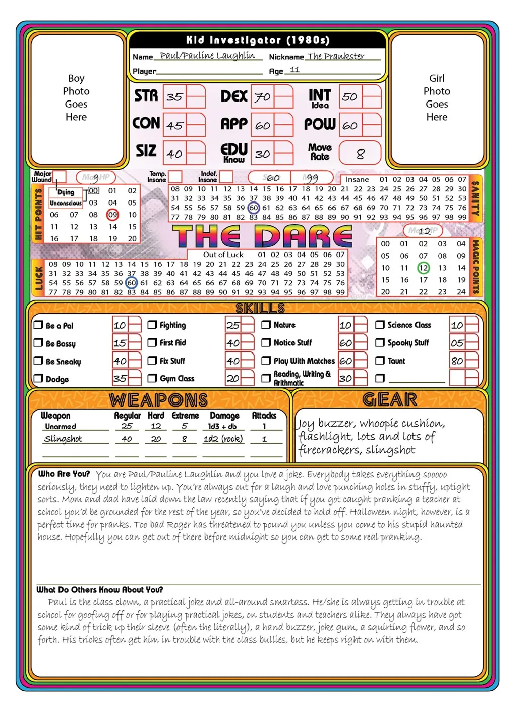

## Пол/Полин Логлин — «Шутник»

**Юный сыщик (1980-е)**

| Имя | Прозвище | Игрок | Возраст |
|---|---|---|---|
| Пол/Полин Логлин | Шутник | — | 11 |

| СИЛ | ВЫН | ТЕЛ | ЛВК | НАР | ОБР (Знание) | ИНТ (Идея) | МОЩ | Скорость |
|---|---|---|---|---|---|---|---|---|
| 35 | 45 | 40 | 70 | 60 | 30 | 50 | 60 | 8 |

**ПЗ** 9 · **ПМ** 12 · **Удача** 60 · **Рассудок** 60 (макс. 99)

*На листе — шкалы ПЗ, Рассудка, Удачи и ПМ с клетками для отметок «Серьёзная рана», «При смерти», «Без сознания», «Временное безумие», «Бессрочное безумие»; в углах — рамки «Фото мальчика» и «Фото девочки» для своего портрета.*

**Навыки**

| Навык | % | Навык | % | Навык | % | Навык | % |
|---|---|---|---|---|---|---|---|
| Быть другом | 10 | Драка | 25 | Природа | 10 | Школьные науки | 10 |
| Командовать | 15 | Первая помощь | 40 | Замечать всякое | 60 | Жуткие штуки | 05 |
| Красться | 40 | Чинить вещи | 40 | Играть со спичками | 60 | Дразнить | 80 |
| Уклонение | 35 | Физкультура | 20 | Чтение, письмо и счёт | 30 | — |  |

**Оружие**

| Оружие | Обычный | Трудный | Чрезвычайный | Урон | Атак |
|---|---|---|---|---|---|
| Без оружия | 25 | 12 | 5 | 1d3 + БкУ | 1 |
| Рогатка | 40 | 20 | 8 | 1d2 (камень) | 1 |

**Снаряжение:** Шокер-рукопожатие, подушка-пердушка, фонарик, много-много петард, рогатка.

### Кто ты?

Ты — Пол / Полин Логлин и обожаешь шутки. Все воспринимают всё сли-и-ишком серьёзно, им надо расслабиться. Ты всегда ищешь, над чем посмеяться, и любишь сбивать спесь с надутых зануд. Недавно мама с папой твёрдо сказали: попадёшься на розыгрыше учителя в школе — будешь наказан(а) до конца года, так что ты решил(а) пока притормозить. Зато Хэллоуин — идеальная ночь для розыгрышей. Жаль, Роджер пригрозил тебя отлупить, если не придёшь в его дурацкий дом с привидениями. Может, получится выбраться оттуда до полуночи и заняться настоящими розыгрышами.

### Что о тебе знают другие?

Пол — классный шут, мастер розыгрышей и вообще умник. Его(её) вечно наказывают в школе за дурачество и шутки над учениками и учителями. У него(неё) всегда что-то припрятано в рукаве (часто буквально): шокер для рукопожатия, жвачка с подвохом, брызгающий цветок и тому подобное. Из-за этих шуток он часто попадает в неприятности с местными задирами, но не унимается.
