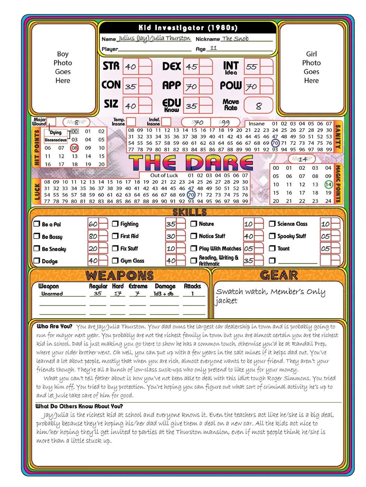

## Джулиус (Джей)/Джулия Тёрстон — «Сноб»

**Юный сыщик (1980-е)**

| Имя | Прозвище | Игрок | Возраст |
|---|---|---|---|
| Джулиус (Джей)/Джулия Тёрстон | Сноб | — | 11 |

| СИЛ | ВЫН | ТЕЛ | ЛВК | НАР | ОБР (Знание) | ИНТ (Идея) | МОЩ | Скорость |
|---|---|---|---|---|---|---|---|---|
| 40 | 35 | 40 | 45 | 70 | 35 | 55 | 70 | 8 |

**ПЗ** 8 · **ПМ** 14 · **Удача** 70 · **Рассудок** 70 (макс. 99)

*На листе — шкалы ПЗ, Рассудка, Удачи и ПМ с клетками для отметок «Серьёзная рана», «При смерти», «Без сознания», «Временное безумие», «Бессрочное безумие»; в углах — рамки «Фото мальчика» и «Фото девочки» для своего портрета.*

**Навыки**

| Навык | % | Навык | % | Навык | % | Навык | % |
|---|---|---|---|---|---|---|---|
| Быть другом | 60 | Драка | 35 | Природа | 10 | Школьные науки | 10 |
| Командовать | 80 | Первая помощь | 30 | Замечать всякое | 40 | Жуткие штуки | 05 |
| Красться | 20 | Чинить вещи | 10 | Играть со спичками | 05 | Дразнить | 05 |
| Уклонение | 40 | Физкультура | 40 | Чтение, письмо и счёт | 35 | — |  |

**Оружие**

| Оружие | Обычный | Трудный | Чрезвычайный | Урон | Атак |
|---|---|---|---|---|---|
| Без оружия | 35 | 17 | 7 | 1d3 + БкУ | 1 |

**Снаряжение:** Часы «Своч», куртка «Мемберз онли».

### Кто ты?

Ты — Джей / Джулия Тёрстон. Твоему папе принадлежит самый большой автосалон в городе, и в следующем году он, скорее всего, будет баллотироваться в мэры. Ваша семья, наверное, не самая богатая в городе, но ты почти уверен(а), что ты — самый богатый ребёнок в школе. Папа отдал тебя в эту школу, только чтобы показать, что он «близок к народу», иначе ты учился(лась) бы в «Рэндалл преп», где учился твой старший брат. Ну и ладно: можно потерпеть пару лет на соляных копях, если это поможет папе. Ты многое понял(а) о людях — главным образом то, что, когда ты богат(а), почти все хотят с тобой дружить. Но они тебе не друзья: всё это подхалимы из простонародья, которые притворяются, что ты им нравишься, ради твоих денег.

О чём нельзя рассказать отцу — так это о том, что ты никак не можешь справиться с этим тупым хулиганом Роджером Симмонсом. Ты пытался(лась) его подкупить, пытался(лась) купить защиту. Теперь надеешься выяснить, какими тёмными делишками он занимается, и сдать его в колонию навсегда.

### Что о тебе знают другие?

Джей/Джулия — самый богатый ребёнок в школе, и все это знают. Даже учителя обращаются с ним(ней) как с важной персоной — наверное, надеются, что его(её) папа сделает им скидку на новую машину. Все дети с ним(ней) милы в надежде на приглашение на вечеринки в особняке Тёрстонов, хотя большинство считает, что он(а) изрядно задирает нос.
