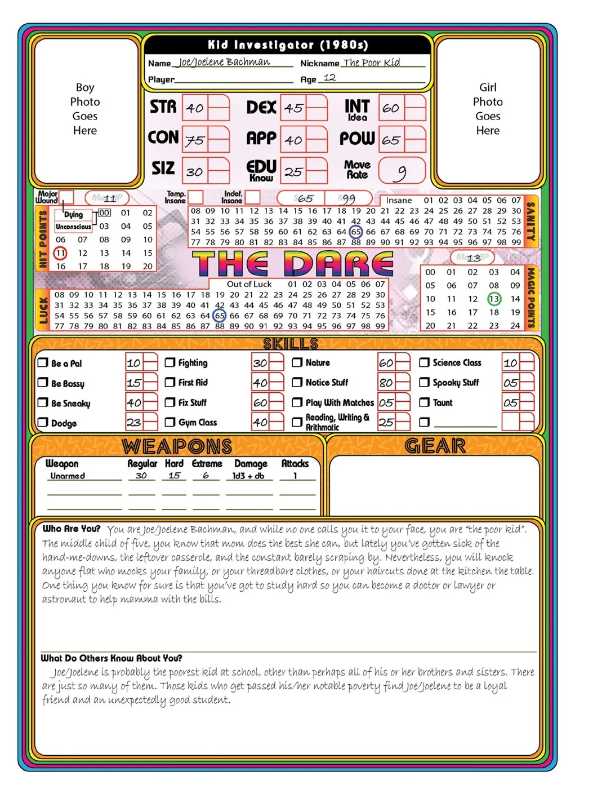

## Джо/Джолин Бакман — «Бедняк»

**Юный сыщик (1980-е)**

| Имя | Прозвище | Игрок | Возраст |
|---|---|---|---|
| Джо/Джолин Бакман | Бедняк | — | 12 |

| СИЛ | ВЫН | ТЕЛ | ЛВК | НАР | ОБР (Знание) | ИНТ (Идея) | МОЩ | Скорость |
|---|---|---|---|---|---|---|---|---|
| 40 | 75 | 30 | 45 | 40 | 25 | 60 | 65 | 9 |

**ПЗ** 11 · **ПМ** 13 · **Удача** 65 · **Рассудок** 65 (макс. 99)

*На листе — шкалы ПЗ, Рассудка, Удачи и ПМ с клетками для отметок «Серьёзная рана», «При смерти», «Без сознания», «Временное безумие», «Бессрочное безумие»; в углах — рамки «Фото мальчика» и «Фото девочки» для своего портрета.*

**Навыки**

| Навык | % | Навык | % | Навык | % | Навык | % |
|---|---|---|---|---|---|---|---|
| Быть другом | 10 | Драка | 30 | Природа | 60 | Школьные науки | 10 |
| Командовать | 15 | Первая помощь | 40 | Замечать всякое | 80 | Жуткие штуки | 05 |
| Красться | 40 | Чинить вещи | 60 | Играть со спичками | 05 | Дразнить | 05 |
| Уклонение | 23 | Физкультура | 40 | Чтение, письмо и счёт | 25 | — |  |

**Оружие**

| Оружие | Обычный | Трудный | Чрезвычайный | Урон | Атак |
|---|---|---|---|---|---|
| Без оружия | 30 | 15 | 6 | 1d3 + БкУ | 1 |

**Снаряжение:** — (графа на листе пуста).

### Кто ты?

Ты — Джо / Джолин Бакман, и, хотя никто не говорит тебе этого в лицо, ты — «бедный ребёнок». Средний из пятерых детей, ты знаешь, что мама делает всё, что может, но в последнее время тебе осточертели обноски, вчерашняя запеканка и вечное «еле сводим концы с концами». И всё же ты уложишь на месте любого, кто посмеётся над твоей семьёй, твоей потёртой одеждой или стрижкой «на кухне за столом». Одно ты знаешь точно: надо усердно учиться, чтобы стать врачом, или юристом, или астронавтом и помогать маме с счетами.

### Что о тебе знают другие?

Джо/Джолин — наверное, самый бедный ребёнок в школе, не считая разве что его(её) братьев и сестёр: их просто очень много. Кто не обращает внимания на его(её) явную бедность, находит в Джо/Джолин верного друга и неожиданно хорошего ученика.
